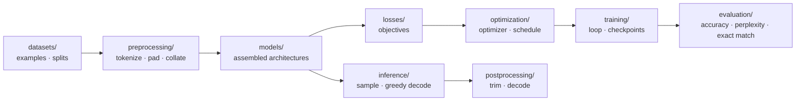

# Deep Learning Laboratory

**A laboratory notebook you can run.** Every primitive is written from scratch,
every experiment is reproducible on a laptop, and every paper method is one
file away from an implementation.

[](https://www.python.org/)
[](https://pytorch.org/)
[](LICENSE)
[](https://github.com/Tqhuyen/deep-learning-laboratory/actions/workflows/tests.yml)

The goal is not to hide deep learning behind an API. It is to make the
distance between an equation in a paper and a runnable experiment small enough
to cross in an afternoon.



`blocks/` sits underneath the stages: attention, positions, normalisation and
feed-forward are shared by every architecture and are not duplicated per model.

## What is inside

| location | what you learn | where it appears in papers |
|---|---|---|
| `laboratory/blocks/` | attention, positional encodings, normalisation, feed-forward | every transformer variant |
| `laboratory/datasets/` | next-token windows, aligned sequence pairs, splits | dataset construction |
| `laboratory/preprocessing/` | character/word/BPE tokenizers, padding, teacher forcing | tokenization and batching |
| `laboratory/models/` | transformer (GPT, seq2seq), RNN/LSTM/GRU | model architectures |
| `laboratory/losses/` | token cross-entropy with `ignore_index` | objectives |
| `laboratory/optimization/` | AdamW/Adam/SGD factory, warmup/cosine, Noam | optimisation ablations |
| `laboratory/training/` | loop, clipping, mixed precision, checkpoints | every experiment |
| `laboratory/evaluation/` | metrics, statistics, diagnostics, loss landscapes | reported results and mechanism checks |
| `laboratory/inference/` | temperature/top-k sampling, greedy decoding | generation |
| `laboratory/postprocessing/` | trimming at `<eos>`, ids to task output | decoding outputs |
| `laboratory/experiment.py` | tiers, seeds, run directories | reproducibility |

Two rules make the code readable:

* **Masks are explicit.** A boolean mask is `True` where attention is allowed.
  This is the same convention as PyTorch's fused attention, so the manual
  implementation can be swapped for the kernel later without changing callers.
* **Shapes and equations are in docstrings.** `(batch, sequence, width)` is
  stated at every module boundary, and the gate equations are written out.

## Where new work goes

Directories are **pipeline stages**, files are **families**, so every addition
has one obvious home:

| adding | home |
|---|---|
| reusable block: convolution, new norm, new activation | `laboratory/blocks/<topic>.py` |
| dataset or split | `laboratory/datasets/<task>.py` |
| tokenizer, transform, collator | `laboratory/preprocessing/<modality>.py` |
| complete architecture: ResNet, ViT, JEPA | `laboratory/models/<family>.py` |
| loss: cross-entropy, InfoNCE, latent MSE | `laboratory/losses/<task>.py` |
| optimizer or schedule | `laboratory/optimization/` |
| training regime: EMA teacher, RL, distillation | the experiment's `run.py` first; promote to `laboratory/training/` when a second experiment needs it |
| metric or task evaluator | `laboratory/evaluation/` |
| generation strategy: top-p, beam, KV cache | `laboratory/inference/` |
| output decoding: detokenize, boxes, labels | `laboratory/postprocessing/` |
| a paper reproduction | `experiments/<area>/<name>/run.py` |

A CNN experiment therefore lands as `blocks/convolution.py` (conv + residual
block), `models/convnet.py` (assembled network), `losses/classification.py`
(cross-entropy) and `experiments/vision/cnn_classification/run.py`. JEPA reuses
the same encoder block and adds `models/jepa.py` plus
`losses/predictive.py`. Nothing is copied per architecture: a different loss or
optimizer is a different module in its stage directory, chosen by the experiment.
The full convention is in [`docs/conventions.md`](docs/conventions.md#1-layout).

## Repository layout

```text
deep-learning-laboratory/
├── laboratory/
│   ├── blocks/             shared components: attention, positions, norm, feed-forward
│   ├── datasets/           examples and splits
│   ├── preprocessing/      tokenizers, padding, collators
│   ├── models/             assembled architectures: transformer, recurrent
│   ├── losses/             objectives
│   ├── optimization/       optimizers and schedules
│   ├── training/           loop and checkpoints
│   ├── evaluation/         metrics and task evaluators
│   ├── inference/          sampling and greedy decoding
│   ├── postprocessing/     ids to task output
│   ├── experiment.py       tier and artifact conventions
│   └── utilities.py        seeds, devices, masks, running averages
├── experiments/
│   ├── language_modeling/
│   │   ├── character_gpt/  decoder-only transformer, next-token prediction
│   │   └── recurrent_generation/  matched-parameter generation comparison
│   ├── sequence_to_sequence/
│   │   └── reversal/       encoder–decoder, cross-attention, teacher forcing
│   ├── sequence_classification/
│   │   └── sentiment/      matched-parameter RNN / GRU / LSTM on SST-2
│   └── recurrent/
│       └── language_model/ same corpus, RNN / LSTM / GRU
├── tests/
│   ├── unit/               mirrors laboratory/: one directory per stage
│   └── smoke/              every experiment at the tiny tier
├── analysis/               post-hoc tools over trained checkpoints
│   ├── loss_landscape.py   3-D filter-normalised surfaces
│   └── context_sweep.py    BPC versus evaluation context
├── notebooks/
│   └── recurrent_comparison.ipynb  Kaggle GPU run of both comparison studies
├── results/
│   └── recurrent_comparison/  reports, per-seed tables and figures
├── data/                   tiny Shakespeare, SST-2 fixture, prepare_sst2.py
├── docs/
│   ├── conventions.md      tiers, scaling, testing, reproducibility
│   └── paper-to-code.md    workflow and worked examples
├── pyproject.toml
└── README.md
```

## Quickstart

```bash
git clone https://github.com/Tqhuyen/deep-learning-laboratory.git
cd deep-learning-laboratory
python -m pip install -e ".[development]"

# only needed for the sentiment development/full tiers
python data/prepare_sst2.py

# five CPU seconds: does the whole pipeline run?
python experiments/language_modeling/character_gpt/run.py --tier tiny

# one minute on CPU: does the loss fall?
python experiments/language_modeling/character_gpt/run.py --tier smoke
```

Artifacts for every run land in `runs/<area>/<name>/<tier>/`:
`config.json`, `metrics.json`, checkpoints (`checkpoint.pt`, or
`checkpoints/<architecture>.pt` for comparison studies) and, where useful,
samples or figures.

## Experiments

| experiment | command | what it demonstrates |
|---|---|---|
| character GPT | `python experiments/language_modeling/character_gpt/run.py --tier development` | tokenization, learned positions, causal attention, sampling |
| sequence reversal | `python experiments/sequence_to_sequence/reversal/run.py --tier development` | encoder–decoder, cross-attention, teacher forcing, greedy decoding, exact match |
| recurrent LM | `python experiments/recurrent/language_model/run.py --tier development --cell lstm` | RNN/LSTM/GRU on the same data and training loop as the transformer |
| sentiment comparison | `python experiments/sequence_classification/sentiment/run.py --tier development` | parameter-matched RNN/GRU/LSTM, paired bootstrap, McNemar, gradient reach |
| generation comparison | `python experiments/language_modeling/recurrent_generation/run.py --tier development` | matched-parameter BPC comparison, bootstrap over windows, gradient reach |

All experiments share the tokenizer, batching and trainer. Changing `--cell` or
the model width is an architecture experiment, not a rewrite. The two
comparison studies run 3 cells × 3 seeds and write a report, raw predictions
and figures.

### Tiers

| tier | budget | use it for |
|---|---|---|
| `tiny` | seconds, CPU | shapes, masks, one backward pass |
| `smoke` | about a minute, CPU | sanity-check that learning happens |
| `development` | minutes, one GPU | iterating on a hypothesis |
| `full` | as much as you have | numbers you would report |

`tiny` must always work on a laptop; the smoke test suite enforces that.

```bash
pytest -q                 # full suite, CPU, under a minute (includes every tiny run)
pytest tests/unit -q      # maths and invariants only
```

### Recurrent comparison study

The two comparison experiments answer the same question on different tasks:
does RNN, GRU or LSTM win **at equal parameter count and equal optimizer
steps**, and is the difference larger than seed and test noise?

* parameter budgets are matched by solving
  `m * (I*H + H^2 + 2H)` (`m = 1, 3, 4`) for the hidden size, so an LSTM gets
  fewer units than an RNN for the same total parameters;
* 3 cells × 3 seeds in the `development` tier, identical data, optimiser,
  schedule, batch size and steps;
* reports include 95 % paired bootstrap intervals, exact McNemar tests with
  Holm correction (classification) and paired bootstrap p-values (generation);
* the mechanism is probed by measuring `||dL/dh_t||` for `L = ||h_last||^2`,
  i.e. how far back the final state can see, plus gate-free gradient slopes;
* figures: validation curves, final metrics with error bars, gradient decay,
  and accuracy by sequence length.

`notebooks/recurrent_comparison.ipynb` runs both studies at the `development`
tier on a Kaggle GPU and displays the reports and figures inline.

Measured results (development tier, 3 seeds, Kaggle GPU):

| task | RNN | GRU | LSTM | conditional conclusion |
|---|---:|---:|---:|---|
| SST-2 accuracy | 0.674 | **0.739** | **0.739** | gated cells beat the RNN; GRU ≈ LSTM |
| Shakespeare BPC (lower is better) | **2.384** | 2.407 | 2.546 | RNN leads, but only the LSTM gap is stable across seeds |

The full per-seed tables, confidence intervals, statistical tests, figures and
interpretation are in
[`results/recurrent_comparison/README.md`](results/recurrent_comparison/README.md).
That report also contains the 3-D loss surfaces and a 32–256 character context
sweep: the surfaces are local diagnostics, and the sweep shows the ordering is
stable across evaluation contexts but remains conditional on the corpus,
parameter budget and training context.

## Learning path

1. Read `laboratory/datasets/language.py` and
   `laboratory/preprocessing/`: text becomes tensors, and the target shift is
   the entire "self-supervision" trick.
2. Read `laboratory/blocks/positional_encoding.py`: attention is order-blind;
   positions are the fix.
3. Read `laboratory/blocks/attention.py`: six lines of maths plus explicit
   masks.
4. Read `laboratory/models/transformer.py`: a block is attention + MLP +
   residual, a model is a stack of blocks.
5. Read `laboratory/losses/language.py`,
   `laboratory/optimization/`, and `laboratory/training/trainer.py`: the path
   from logits to an updated weight.
6. Read `laboratory/inference/` and `laboratory/evaluation/`: how a trained
   model is sampled and scored.
7. Run the three experiments, then read `docs/paper-to-code.md` and implement a
   method you care about.

## Implementing a paper

The workflow is four steps, documented in full in
[`docs/paper-to-code.md`](docs/paper-to-code.md):

1. locate which component the paper changes (the mapping table in
   [`docs/conventions.md`](docs/conventions.md#7-where-a-papers-idea-usually-lands));
2. implement it as a drop-in with the same forward signature, shapes in the
   docstring;
3. write the property test that would fail if the idea were implemented wrongly
   (causality, relative-position invariance, norm formula, weight-copy
   equivalence against a fused kernel);
4. add a `tiny` preset, run it, then confirm a learning signal at `smoke`
   before spending GPU hours.

The repository already provides the configuration surface most papers touch:
`n_kv_heads` (grouped-query and multi-query attention), `pos="rope"` /
`pos="learned"` / `pos="sinusoidal"`, `norm="layernorm"` / `"rmsnorm"`,
`ffn="mlp"` / `"swiglu"`, and `norm_first` for pre- or post-normalisation.

## Design principles

* **Correctness first, then readability.** Every nontrivial module has a test
  that proves a property, not a snapshot.
* **Two axes: stages and shared blocks.** `datasets -> preprocessing -> models
  -> losses -> optimization -> training -> evaluation`, then `inference ->
  postprocessing`. `blocks/` holds the components every model reuses. A new
  architecture changes only `models/`; a new loss changes only `losses/`.
* **No unexplained magic.** No `nn.Transformer`, no `nn.LSTM`: the cells,
  masks and residual paths are visible and modifiable.
* **One variable at a time.** Presets, seeds and saved configs make comparisons
  meaningful; the conventions file defines what "matched compute" means.
* **Laptop first.** If a change cannot be validated on CPU in seconds, it is not
  ready to be scaled.

## Ideas for the next experiments

These are extension points, not claims about what is implemented today:

* key/value caching for generation, and a measured speed comparison;
* top-p and beam sampling next to the existing temperature/top-k path;
* sliding-window attention, implemented as a mask and tested for locality;
* mixture-of-experts feed-forward routing inside `EncoderLayer`;
* parameter-efficient fine-tuning (adapters, LoRA) on the language model;
* state-space and linear-attention sequence mixers to compare against attention;
* a real translation corpus behind the existing `Seq2SeqDataset` interface.

## References

* Vaswani et al., *Attention Is All You Need* — <https://arxiv.org/abs/1706.03762>
* Ba, Kiros, Hinton, *Layer Normalization* — <https://arxiv.org/abs/1607.06450>
* Sennrich et al., *Neural Machine Translation of Rare Words with Subword Units* — <https://arxiv.org/abs/1508.07909>
* Hochreiter & Schmidhuber, *Long Short-Term Memory* — <https://doi.org/10.1162/neco.1997.9.8.1735>
* Cho et al., *Learning Phrase Representations using RNN Encoder–Decoder* — <https://arxiv.org/abs/1406.1078>
* Su et al., *RoFormer: Enhanced Transformer with Rotary Position Embedding* — <https://arxiv.org/abs/2104.09864>
* Press, Smith, Lewis, *Train Short, Test Long: Attention with Linear Biases* — <https://arxiv.org/abs/2108.12409>
* Shazeer, *Fast Transformer Decoding: One Write-Head is All You Need* — <https://arxiv.org/abs/1911.02150>
* Ainslie et al., *GQA: Training Generalized Multi-Query Transformer Models* — <https://arxiv.org/abs/2305.13245>
* Zhang & Sennrich, *Root Mean Square Layer Normalization* — <https://arxiv.org/abs/1910.07467>
* Shazeer, *GLU Variants Improve Transformer* — <https://arxiv.org/abs/2002.05202>
* Karpathy, *nanoGPT* — <https://github.com/karpathy/nanoGPT>

The corpus is the public-domain Tiny Shakespeare from Karpathy's char-rnn.

## License

MIT. See [LICENSE](LICENSE).
