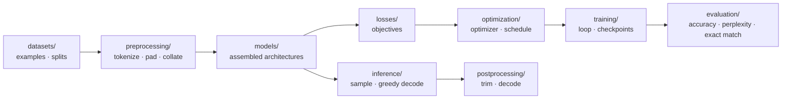

# Deep Learning Laboratory

**A laboratory notebook you can run.** Every primitive is written from scratch,
every experiment is reproducible on a laptop, and every paper method is one
file away from an implementation.

[](https://www.python.org/)
[](https://pytorch.org/)
[](LICENSE)
[](https://github.com/Tqhuyen/deep-learning-laboratory/actions/workflows/tests.yml)

The goal is not to hide deep learning behind an API. It is to make the
distance between an equation in a paper and a runnable experiment small enough
to cross in an afternoon.



`blocks/` sits underneath the stages: attention, positions, normalisation and
feed-forward are shared by every architecture and are not duplicated per model.

## What is inside

| location | what you learn | where it appears in papers |
|---|---|---|
| `laboratory/blocks/` | attention, positional encodings, normalisation, feed-forward | every transformer variant |
| `laboratory/datasets/` | next-token windows, aligned sequence pairs, splits | dataset construction |
| `laboratory/preprocessing/` | character/word/BPE tokenizers, padding, teacher forcing | tokenization and batching |
| `laboratory/models/` | transformer (GPT, seq2seq), RNN/LSTM/GRU | model architectures |
| `laboratory/losses/` | token cross-entropy with `ignore_index` | objectives |
| `laboratory/optimization/` | Muon (default; AdamW for embeddings, heads, biases, gains), AdamW/Adam/SGD factory, warmup/cosine, Noam | optimisation ablations |
| `laboratory/training/` | loop, clipping, mixed precision, checkpoints | every experiment |
| `laboratory/evaluation/` | metrics, statistics, diagnostics, loss landscapes | reported results and mechanism checks |
| `laboratory/inference/` | temperature/top-k sampling, greedy decoding | generation |
| `laboratory/postprocessing/` | trimming at `<eos>`, ids to task output | decoding outputs |
| `laboratory/experiment.py` | tiers, seeds, run directories | reproducibility |
| `laboratory/agents/` | ReAct, tool calling, plan-and-execute, Reflexion, self-consistency, debate over free hosted LLMs; routing across 37 free providers | LLM agent architectures |

Two rules make the code readable:

* **Masks are explicit.** A boolean mask is `True` where attention is allowed.
  This is the same convention as PyTorch's fused attention, so the manual
  implementation can be swapped for the kernel later without changing callers.
* **Shapes and equations are in docstrings.** `(batch, sequence, width)` is
  stated at every module boundary, and the gate equations are written out.

## The denoising study

The largest study in this repository asks one narrow question: what does a *frozen* pretrained diffusion model
actually buy for Gaussian denoising, measured so that the answer survives a skeptical reader? It lives in `results/`
and is written up in [`results/paper`](results/paper/README.md).

What it found, in the order the evidence forces:

| finding | number | where |
|---|---|---|
| One network evaluation is within 0.02 dB of DMID's 1500-evaluation ensemble, and DMID's own multi-evaluation chain is 0.11–0.14 dB *worse* than one step on matched Gaussian noise | −0.128 / −0.137 / −0.114 dB, 0/110 images better | [`diffusion_benchmark/tile_rule`](results/diffusion_benchmark/tile_rule/README.md) |
| The prior's edge over supervised denoisers is **data scale**: a supervised SwinIR trained on 100 k ImageNet images matches it within ±0.05 dB at σ 25 | 31.84 / 33.14 / 33.44 / 33.21 vs ours 31.86 / 33.12 / 33.49 | [`paper/prior_art.md`](results/paper/prior_art.md) |
| Grayscale needed a construction: an exact lift with isotropic chroma noise. It gives the first diffusion-prior Set12/BSD68 numbers and beats every released supervised gray denoiser on identical draws | BSD68 32.039 / 29.623 / 26.753; Xformer 68/68 images | [`gray_lift`](results/gray_lift/README.md) |
| On Urban100 the pipeline beats the strongest *released* supervised model without an external prior, paired on all 100 images | **+0.065 dB** at σ 25, **+0.220 dB** at σ 50; replicated on 3 draws at σ 50 (±0.0027) and 2 at σ 25 | [`urban100/full100`](results/urban100/full100/README.md), [`seed_replication`](results/urban100/seed_replication/README.md) |
| At σ 15 there is **no** win, and one measured quantity says why | context deficit −0.082 dB at σ 15 against −0.187 at σ 50 | [`adaptation`](results/adaptation/README.md) |
| Whether per-image adaptation helps is a property of the *image* (ρ = 0.98 across draws) and is predicted before adapting by that same deficit (ρ = −0.44…−0.56) | deficit and gain rank identically across σ and across datasets | [`adaptation`](results/adaptation/README.md) |
| The scoring protocol moves a *fixed* denoiser by more than the margins being ranked, and two architectures agree to 0.02 dB | crop 0.04–0.17 dB, RGB→Y 1.6–2.8 dB, clipped input **−0.48 / −0.99 / −2.46 dB** at σ 15/25/50 (up to −3.81); one published ordering reverses | [`measurement_audit`](results/measurement_audit/README.md) |

Two conventions make the results checkable:

* **Every claim is in [`results/paper/claims.md`](results/paper/claims.md)** with its evidence, its statistic and the
  result that would falsify it. Claims that failed are listed there as failed.
* **Comparisons are paired on the same pixels when they are claimed.** Margins over published numbers are shown only as
  a reference column, because the last row of the table above is how much those numbers can move.

## Where new work goes

Directories are **pipeline stages**, files are **families**, so every addition
has one obvious home:

| adding | home |
|---|---|
| reusable block: convolution, new norm, new activation | `laboratory/blocks/<topic>.py` |
| dataset or split | `laboratory/datasets/<task>.py` |
| tokenizer, transform, collator | `laboratory/preprocessing/<modality>.py` |
| complete architecture: ResNet, ViT, JEPA | `laboratory/models/<family>.py` |
| loss: cross-entropy, InfoNCE, latent MSE | `laboratory/losses/<task>.py` |
| optimizer or schedule | `laboratory/optimization/` |
| training regime: EMA teacher, RL, distillation | the experiment's `run.py` first; promote to `laboratory/training/` when a second experiment needs it |
| metric or task evaluator | `laboratory/evaluation/` |
| generation strategy: top-p, beam, KV cache | `laboratory/inference/` |
| output decoding: detokenize, boxes, labels | `laboratory/postprocessing/` |
| a paper reproduction | `experiments/<area>/<name>/run.py` |

A CNN experiment therefore lands as `blocks/convolution.py` (conv + residual
block), `models/convnet.py` (assembled network), `losses/classification.py`
(cross-entropy) and `experiments/vision/cnn_classification/run.py`. JEPA reuses
the same encoder block and adds `models/jepa.py` plus
`losses/predictive.py`. Nothing is copied per architecture: a different loss or
optimizer is a different module in its stage directory, chosen by the experiment.
The full convention is in [`docs/conventions.md`](docs/conventions.md#1-layout).

## Repository layout

```text
deep-learning-laboratory/
├── laboratory/
│   ├── blocks/             shared components: attention, positions, norm, feed-forward
│   ├── datasets/           examples and splits
│   ├── preprocessing/      tokenizers, padding, collators
│   ├── models/             assembled architectures: transformer, recurrent
│   ├── losses/             objectives
│   ├── optimization/       optimizers and schedules
│   ├── training/           loop and checkpoints
│   ├── evaluation/         metrics and task evaluators
│   ├── inference/          sampling and greedy decoding
│   ├── postprocessing/     ids to task output
│   ├── experiment.py       tier and artifact conventions
│   ├── agents/             LLM agents over free remote models: providers, routing, tools, architectures
│   └── utilities.py        seeds, devices, masks, running averages
├── experiments/
│   ├── agents/
│   │   ├── provider_survey/          which free models answer for your keys, and call tools
│   │   └── architecture_comparison/  agent architectures on the same tasks and model
│   ├── language_modeling/
│   │   ├── character_gpt/  decoder-only transformer, next-token prediction
│   │   └── recurrent_generation/  matched-parameter generation comparison
│   ├── sequence_to_sequence/
│   │   └── reversal/       encoder–decoder, cross-attention, teacher forcing
│   ├── sequence_classification/
│   │   └── sentiment/      matched-parameter RNN / GRU / LSTM on SST-2
│   └── recurrent/
│       └── language_model/ same corpus, RNN / LSTM / GRU
├── tests/
│   ├── unit/               mirrors laboratory/: one directory per stage
│   └── smoke/              every experiment at the tiny tier
├── analysis/               post-hoc tools over trained checkpoints
│   ├── trained_models.py   rebuilds the trained comparison models and data
│   ├── gradient_reach.py   how far back the final state stays sensitive
│   ├── loss_landscape.py   3-D filter-normalised surfaces
│   ├── context_sweep.py    BPC versus evaluation context
│   ├── build_report.py     self-contained HTML report of the comparison
│   ├── jepa_guided_diffusion.py  paired tests and adapter diagnostics for a Kaggle run
│   ├── jepa_adapter_weights.py   reads the JEPA adapter's weights and probe results for hand edits
│   ├── diffusion_tweedie_benchmark.py  paired tests for one-step ADM on CBSD68 / Kodak24 / McMaster
│   └── adm_tweedie_finetune.py  paired tests for ADM fine-tuned on the denoising steps
├── notebooks/
│   ├── recurrent_comparison.ipynb  Kaggle GPU run of both comparison studies
│   ├── jepa_denoise_comparison.ipynb  JEPA-guided ADM vs BM3D / DRUNet / Restormer / SCUNet on Kaggle
│   ├── jepa_guided_diffusion_matched.ipynb  adapter retraining with matched conditioning (prepared, not run)
│   ├── adm_noise_level_and_averaging.ipynb  ADM start step from the image's noise, mean of K samples
│   ├── jepa_adapter_weight_probe.ipynb  forward-pass probes of the adapter's paths
│   ├── jepa_adapter_weight_edits.ipynb  hand edits of the adapter's weights, scored on the 52 cases
│   ├── diffusion_tweedie_benchmark.ipynb  one-step ADM vs DMID-d and supervised denoisers, standard benchmarks
│   ├── adm_tweedie_finetune.ipynb  fine-tuning ADM on the denoising steps (DIV2K); pilot and long run
│   ├── diffusion_prior_ensembles.ipynb  class-mixture posterior means and ensembles of pretrained ADMs
│   ├── real_noise_zero_shot.ipynb  real noise (CC / PolyU / FMDD): pixel-shuffle + one-step ADM, baselines, DMID rescored
│   ├── real_noise_round2.ipynb  real noise round 2: PD ceiling, one step on DMID's noise-transformed images
│   ├── real_noise_round3.ipynb  real noise round 3: DMID's chain with few flip-balanced samples, deterministic chain
│   ├── gray_lift_kill_test.ipynb  gray Set12 / BSD68 with the RGB prior via an isotropic chroma-noise lift
│   ├── gray_lift_r2r.ipynb  gray σ 50: the lift plus per-image R2R adaptation (settings frozen from Urban100 dev-12)
│   ├── gray_baselines_cpu.ipynb  CPU: released SCUNet / DRUNet gray models on the lift's identical noise draws
│   ├── gray_sota_rerun_xformer.ipynb  CPU: released Xformer gray models on the same draws (seed 0)
│   ├── gray_sota_rerun_grl.ipynb  CPU: released GRL-B gray models on the same draws (seed 0, σ 50 first)
│   ├── gray_draw_check.ipynb  CPU: checks that the lift job's two-thread noise draws equal single-threaded draws (seed 0)
│   ├── gray_draw_check_seeds12.ipynb  CPU: the same check for seeds 1 and 2
│   ├── urban100_one_step.ipynb  Urban100 colour, round 1: one step, Restormer on identical noise
│   ├── urban100_tiles.ipynb  Urban100 colour, round 2: whole image vs 384/512/768-px tiles, attention scaling
│   ├── urban100_hidden_ensemble.ipynb  CPU: tile gain on pixels without overlap averaging (saved pilots)
│   ├── urban100_nonlocal_wiener.ipynb  CPU: BM3D Wiener stage with the ADM pilot (oracle gate, then dev-chosen blend)
│   ├── urban100_full.ipynb  frozen tiles + R2R pipeline: all 100 at σ 15, dev-12 at σ 25 / 50 (4 h 39 min)
│   ├── urban100_seed_replication_1.ipynb  Urban100 confirm-88 at σ 50 on a second noise draw, same pipeline
│   ├── urban100_seed_replication_2.ipynb  the same on a third draw (3-seed standard)
│   ├── urban100_s25_seed_1.ipynb  Urban100 confirm-88 at σ 25 on a second noise draw
│   ├── urban100_s25_seed_2.ipynb  prepared, never launched: Kaggle refused the push after five GPU sessions
│   ├── tile_rule_colour.ipynb  384-px tile rule on CBSD68 / Kodak24 / McMaster at every σ, plus DMID's 3-evaluation chain
│   ├── denoise_protocol_effects.ipynb  CPU: one denoiser rescored under every protocol; DMID-d vs GRL-B on the same pixels
│   ├── sure_vs_r2r_cpu.ipynb  CPU: SURE against R2R at equal budget, on DnCNN (a stand-in for the GPU-blocked GainTuning test)
│   ├── protocol_effects_restormer.ipynb  CPU: the same grid with Restormer (cancelled at the 12 h limit after Urban100 σ 15)
│   ├── protocol_effects_restormer_small.ipynb  CPU: the three small sets at σ 15
│   ├── protocol_effects_restormer_s25.ipynb  CPU: the three small sets at σ 25
│   ├── protocol_effects_restormer_s50.ipynb  CPU: the three small sets at σ 50
│   ├── grl_outputs_audit.ipynb  CPU: rescoring GRL-B's released denoising outputs on our test copies
│   ├── grl_outputs_audit_kodak.ipynb  CPU: locating GRL's 496×496 Kodak24 regions and the rotated CBSD68 image
│   ├── r2r_capacity_dev.ipynb  shelved: R2R parameter subsets on DIV2K crops (cannot separate size from content)
│   ├── adaptation_gate_urban100.ipynb  per-image gain tuning of ADM: oracles, R2R, transfer probe (4 images)
│   ├── adaptation_dev12.ipynb  R2R gain tuning on the 12 Urban100 dev images, σ 25 / 50, 30–90 steps
│   └── adaptation_confirm.ipynb  R2R gain tuning with frozen settings: Urban100 confirm-88, Kodak24 / McMaster σ 50
├── results/               one directory per study; results/README.md indexes them
│   ├── recurrent_comparison/  reports, figures and report.html
│   ├── jepa_guided_diffusion/ JEPA-conditioned ADM denoising: report, paired tests, comparisons, noise level, weight edits
│   ├── diffusion_benchmark/   one-step diffusion posterior mean on CBSD68 / Kodak24 / McMaster: report, tables, figures
│   ├── adm_finetune/          fine-tuning pilot: report, paired tests, validation curve
│   ├── prior_ensembles/       class-mixture posterior means and multi-network ensembles: report, scores
│   ├── real_noise/            zero-shot real-noise denoising: report, scores of all three rounds
│   ├── gray_lift/             gray Gaussian denoising with the chroma-noise lift: report, scores
│   ├── urban100/              Urban100 colour, whole image vs tiles: report, scores, paired tests
│   │   ├── full100/           Urban100 full 100 images, frozen pipeline, paired against GRL-B's released outputs
│   │   └── seed_replication/  the σ 50 result on two further noise draws (three-draw standard)
│   ├── capacity_sweep/        parameter-count sweep separating headroom from a noise-fitting tax: report, scores
│   ├── loss_comparison/       SURE against R2R at equal budget, on a CPU-sized denoiser: report, scores
│   ├── measurement_audit/     rescoring released outputs and the cost of the scoring protocol: report, rescored tables
│   ├── adaptation/            per-image R2R adaptation of the one-step denoiser: report, gate scores
│   └── paper/                 draft, claims.md (every claim with its evidence and falsification condition), prior_art.md
├── data/                   tiny Shakespeare, SST-2 fixture, prepare_sst2.py
│   ├── free_models.json    snapshot of free chat models (37 providers)
│   ├── agent_tasks.json    fictional-world tasks for agent experiments
│   └── prepare_free_models.py  refreshes free_models.json
├── docs/
│   ├── agents.md           free-model agents: setup, providers, routing, architectures
│   ├── conventions.md      tiers, scaling, testing, reproducibility
│   └── paper-to-code.md    workflow and worked examples
├── .env.example            provider keys for the agent experiments (copy to .env)
├── pyproject.toml
└── README.md
```

## Quickstart

```bash
git clone https://github.com/Tqhuyen/deep-learning-laboratory.git
cd deep-learning-laboratory
python -m pip install -e ".[development]"

# only needed for the sentiment development/full tiers
python data/prepare_sst2.py

# five CPU seconds: does the whole pipeline run?
python experiments/language_modeling/character_gpt/run.py --tier tiny

# one minute on CPU: does the loss fall?
python experiments/language_modeling/character_gpt/run.py --tier smoke
```

Artifacts for every run land in `runs/<area>/<name>/<tier>/`:
`config.json`, `metrics.json`, checkpoints (`checkpoint.pt`, or
`checkpoints/<architecture>.pt` for comparison studies) and, where useful,
samples or figures.

## Experiments

| experiment | command | what it demonstrates |
|---|---|---|
| character GPT | `python experiments/language_modeling/character_gpt/run.py --tier development` | tokenization, learned positions, causal attention, sampling |
| sequence reversal | `python experiments/sequence_to_sequence/reversal/run.py --tier development` | encoder–decoder, cross-attention, teacher forcing, greedy decoding, exact match |
| recurrent LM | `python experiments/recurrent/language_model/run.py --tier development --cell lstm` | RNN/LSTM/GRU on the same data and training loop as the transformer |
| sentiment comparison | `python experiments/sequence_classification/sentiment/run.py --tier development` | parameter-matched RNN/GRU/LSTM, paired bootstrap, McNemar, gradient reach |
| generation comparison | `python experiments/language_modeling/recurrent_generation/run.py --tier development` | matched-parameter BPC comparison, bootstrap over windows, gradient reach |
| free provider survey | `python experiments/agents/provider_survey/run.py --tier smoke` | which free models answer for your keys, latency, native tool calls |
| agent architecture comparison | `python experiments/agents/architecture_comparison/run.py --tier development --model gpt-oss-120b` | seven agent architectures on the same free model, tools and tasks |

All experiments share the tokenizer, batching and trainer. Changing `--cell` or
the model width is an architecture experiment, not a rewrite. The two
comparison studies run 3 cells × 3 seeds and write a report, raw predictions
and figures.

### Tiers

| tier | budget | use it for |
|---|---|---|
| `tiny` | seconds, CPU | shapes, masks, one backward pass |
| `smoke` | about a minute, CPU | sanity-check that learning happens |
| `development` | minutes, one GPU | iterating on a hypothesis |
| `full` | as much as you have | numbers you would report |

`tiny` must always work on a laptop; the smoke test suite enforces that.

```bash
pytest -q                 # full suite, CPU, under a minute (includes every tiny run)
pytest tests/unit -q      # maths and invariants only
```

### Recurrent comparison study

The two comparison experiments answer the same question on different tasks:
does RNN, GRU or LSTM win **at equal parameter count and equal optimizer
steps**, and is the difference larger than seed and test noise?

* parameter budgets are matched by solving
  `m * (I*H + H^2 + 2H)` (`m = 1, 3, 4`) for the hidden size, so an LSTM gets
  fewer units than an RNN for the same total parameters;
* 3 cells × 3 seeds in the `development` tier, identical data, optimiser,
  schedule, batch size and steps;
* reports include 95 % paired bootstrap intervals, exact McNemar tests with
  Holm correction (classification) and paired bootstrap p-values (generation);
* the mechanism is probed by measuring `||d ||h_T||^2 / d x_t||` on unpadded
  sequences, i.e. how far back the final state still depends on its inputs,
  and fitting its per-step decay;
* figures: validation curves, final metrics with error bars, gradient decay,
  and accuracy by sequence length.

`notebooks/recurrent_comparison.ipynb` runs both studies at the `development`
tier on a Kaggle GPU and displays the reports and figures inline.

Measured results (development tier, 3 seeds, Kaggle GPU):

| task | RNN | GRU | LSTM | conditional conclusion |
|---|---:|---:|---:|---|
| SST-2 accuracy | 0.674 | **0.739** | **0.739** | gated cells beat the RNN; GRU ≈ LSTM |
| Shakespeare BPC (lower is better) | **2.384** | 2.407 | 2.546 | RNN leads, but only the LSTM gap is stable across seeds |

The full per-seed tables, confidence intervals, statistical tests, figures and
interpretation are in
[`results/recurrent_comparison/README.md`](results/recurrent_comparison/README.md),
and as a detailed self-contained HTML report (Vietnamese, interactive charts,
3-D surfaces, proofs separated from evidence) in
[`results/recurrent_comparison/report.html`](results/recurrent_comparison/report.html).
They also contain the gradient-reach probe, the 3-D loss surfaces and a 32–256
character context sweep: the surfaces are local diagnostics, and the sweep shows
the ordering is stable across evaluation contexts but remains conditional on
the corpus, parameter budget and training context.

### Agents on free models

`laboratory/agents/` runs agent architectures on free hosted models only; it
trains nothing and needs no GPU. Four providers (Kilo, OVH, LLM7, AI Horde)
answer with no key; the others take a free key in `.env`.

```bash
cp .env.example .env                                              # add any keys you have
python experiments/agents/provider_survey/run.py --tier smoke     # what answers for you
python experiments/agents/architecture_comparison/run.py --tier tiny   # offline, scripted
python experiments/agents/architecture_comparison/run.py --tier development --model gpt-oss-120b
```

Agent runs write `transcripts.jsonl` instead of a checkpoint. Providers, model
specifications, routing and caveats are in [`docs/agents.md`](docs/agents.md).

## Learning path

1. Read `laboratory/datasets/language.py` and
   `laboratory/preprocessing/`: text becomes tensors, and the target shift is
   the entire "self-supervision" trick.
2. Read `laboratory/blocks/positional_encoding.py`: attention is order-blind;
   positions are the fix.
3. Read `laboratory/blocks/attention.py`: six lines of maths plus explicit
   masks.
4. Read `laboratory/models/transformer.py`: a block is attention + MLP +
   residual, a model is a stack of blocks.
5. Read `laboratory/losses/language.py`,
   `laboratory/optimization/`, and `laboratory/training/trainer.py`: the path
   from logits to an updated weight.
6. Read `laboratory/inference/` and `laboratory/evaluation/`: how a trained
   model is sampled and scored.
7. Run the three experiments, then read `docs/paper-to-code.md` and implement a
   method you care about.

## Implementing a paper

The workflow is four steps, documented in full in
[`docs/paper-to-code.md`](docs/paper-to-code.md):

1. locate which component the paper changes (the mapping table in
   [`docs/conventions.md`](docs/conventions.md#7-where-a-papers-idea-usually-lands));
2. implement it as a drop-in with the same forward signature, shapes in the
   docstring;
3. write the property test that would fail if the idea were implemented wrongly
   (causality, relative-position invariance, norm formula, weight-copy
   equivalence against a fused kernel);
4. add a `tiny` preset, run it, then confirm a learning signal at `smoke`
   before spending GPU hours.

The repository already provides the configuration surface most papers touch:
`n_kv_heads` (grouped-query and multi-query attention), `pos="rope"` /
`pos="learned"` / `pos="sinusoidal"`, `norm="layernorm"` / `"rmsnorm"`,
`ffn="mlp"` / `"swiglu"`, and `norm_first` for pre- or post-normalisation.

## Design principles

* **Correctness first, then readability.** Every nontrivial module has a test
  that proves a property, not a snapshot.
* **Two axes: stages and shared blocks.** `datasets -> preprocessing -> models
  -> losses -> optimization -> training -> evaluation`, then `inference ->
  postprocessing`. `blocks/` holds the components every model reuses. A new
  architecture changes only `models/`; a new loss changes only `losses/`.
* **No unexplained magic.** No `nn.Transformer`, no `nn.LSTM`: the cells,
  masks and residual paths are visible and modifiable.
* **One variable at a time.** Presets, seeds and saved configs make comparisons
  meaningful; the conventions file defines what "matched compute" means.
* **Laptop first.** If a change cannot be validated on CPU in seconds, it is not
  ready to be scaled.

## Ideas for the next experiments

These are extension points, not claims about what is implemented today:

* key/value caching for generation, and a measured speed comparison;
* top-p and beam sampling next to the existing temperature/top-k path;
* sliding-window attention, implemented as a mask and tested for locality;
* mixture-of-experts feed-forward routing inside `EncoderLayer`;
* parameter-efficient fine-tuning (adapters, LoRA) on the language model;
* state-space and linear-attention sequence mixers to compare against attention;
* a real translation corpus behind the existing `Seq2SeqDataset` interface.

## References

* Vaswani et al., *Attention Is All You Need* — <https://arxiv.org/abs/1706.03762>
* Ba, Kiros, Hinton, *Layer Normalization* — <https://arxiv.org/abs/1607.06450>
* Sennrich et al., *Neural Machine Translation of Rare Words with Subword Units* — <https://arxiv.org/abs/1508.07909>
* Hochreiter & Schmidhuber, *Long Short-Term Memory* — <https://doi.org/10.1162/neco.1997.9.8.1735>
* Cho et al., *Learning Phrase Representations using RNN Encoder–Decoder* — <https://arxiv.org/abs/1406.1078>
* Su et al., *RoFormer: Enhanced Transformer with Rotary Position Embedding* — <https://arxiv.org/abs/2104.09864>
* Press, Smith, Lewis, *Train Short, Test Long: Attention with Linear Biases* — <https://arxiv.org/abs/2108.12409>
* Shazeer, *Fast Transformer Decoding: One Write-Head is All You Need* — <https://arxiv.org/abs/1911.02150>
* Ainslie et al., *GQA: Training Generalized Multi-Query Transformer Models* — <https://arxiv.org/abs/2305.13245>
* Zhang & Sennrich, *Root Mean Square Layer Normalization* — <https://arxiv.org/abs/1910.07467>
* Shazeer, *GLU Variants Improve Transformer* — <https://arxiv.org/abs/2002.05202>
* Karpathy, *nanoGPT* — <https://github.com/karpathy/nanoGPT>
* Yao et al., *ReAct: Synergizing Reasoning and Acting in Language Models* — <https://arxiv.org/abs/2210.03629>
* Wang et al., *Plan-and-Solve Prompting* — <https://arxiv.org/abs/2305.04091>
* Shinn et al., *Reflexion: Language Agents with Verbal Reinforcement Learning* — <https://arxiv.org/abs/2303.11366>
* Wang et al., *Self-Consistency Improves Chain of Thought Reasoning in Language Models* — <https://arxiv.org/abs/2203.11171>
* Du et al., *Improving Factuality and Reasoning in Language Models through Multiagent Debate* — <https://arxiv.org/abs/2305.14325>

The corpus is the public-domain Tiny Shakespeare from Karpathy's char-rnn.

## License

MIT. See [LICENSE](LICENSE).
