# Deep Learning Laboratory

**A laboratory notebook you can run.** Every primitive is written from scratch,
every experiment is reproducible on a laptop, and every paper method is one
file away from an implementation.

[](https://www.python.org/)
[](https://pytorch.org/)
[](LICENSE)
[](https://github.com/Tqhuyen/deep-learning-laboratory/actions/workflows/tests.yml)

The goal is not to hide deep learning behind an API. It is to make the
distance between an equation in a paper and a runnable experiment small enough
to cross in an afternoon.

```mermaid
flowchart LR
    corpus["Corpus /<br/>parallel pairs"] --> tokenize["Tokenization<br/>character · word · byte-pair"]
    tokenize --> batch["Batching<br/>LM windows · teacher forcing"]
    batch --> position["Embedding + positions<br/>learned · sinusoidal · RoPE · ALiBi"]
    position --> mixer["Sequence mixer<br/>attention · RNN · LSTM · GRU"]
    mixer --> head["Head + objective<br/>next token · sequence to sequence"]
    head --> train["Training loop<br/>AdamW · warmup + cosine · clipping"]
    train --> outcome["Checkpoint · metrics · samples"]
```



## What is inside

| location | what you learn | where it appears in papers |
|---|---|---|
| `laboratory/blocks/attention.py` | scaled dot-product, multi-head, grouped-query, cross-attention, masks | the core of every transformer variant |
| `laboratory/blocks/positional_encoding.py` | sinusoidal, learned, RoPE, ALiBi | position encoding ablations |
| `laboratory/blocks/normalization.py` | LayerNorm, RMSNorm | normalisation ablations |
| `laboratory/blocks/feedforward.py` | feed-forward blocks, SwiGLU, activations | block design |
| `laboratory/models/transformer.py` | encoder and decoder layers, GPT, encoder–decoder with greedy decoding | GPT, T5/BART-style models |
| `laboratory/models/recurrent.py` | RNN, LSTM and GRU cells written from the equations | pre-transformer sequence models |
| `laboratory/objectives/language.py` | token cross-entropy with padding handled | every language-model paper |
| `laboratory/data/tokenization.py` | character, word and BPE tokenizers, trained from scratch | subword tokenization, vocabulary design |
| `laboratory/data/batching.py` | LM windows, sequence-to-sequence batching, teacher forcing | every training pipeline |
| `laboratory/training/` | loop, schedules, metrics, checkpointing | every experiment |
| `laboratory/experiment.py` | tiers, seeds, run directories | how experiments stay comparable |

Two rules make the code readable:

* **Masks are explicit.** A boolean mask is `True` where attention is allowed.
  This is the same convention as PyTorch's fused attention, so the manual
  implementation can be swapped for the kernel later without changing callers.
* **Shapes and equations are in docstrings.** `(batch, sequence, width)` is
  stated at every module boundary, and the gate equations are written out.

## Where new work goes

Directories are **roles**, files are **families**, so every addition has one
obvious home:

| adding | home |
|---|---|
| reusable block: convolution, new norm, new activation | `laboratory/blocks/<topic>.py` |
| complete architecture: ResNet, ViT, JEPA | `laboratory/models/<family>.py` |
| loss: cross-entropy, InfoNCE, latent MSE | `laboratory/objectives/<task>.py` |
| data pipeline for a modality: images, audio | `laboratory/data/<modality>.py` |
| new training regime: EMA teacher, RL, distillation | the experiment's `run.py` first; promote to `laboratory/training/` when a second experiment needs it |
| a paper reproduction | `experiments/<area>/<name>/run.py` |

A CNN experiment therefore lands as `blocks/convolution.py` (conv + residual
block), `models/convnet.py` (assembled network), `objectives/classification.py`
(cross-entropy) and `experiments/vision/cnn_classification/run.py`. JEPA reuses
the same encoder block and adds `models/jepa.py` plus
`objectives/predictive.py`. The full convention is in
[`docs/conventions.md`](docs/conventions.md#1-layout).

## Repository layout

```text
deep-learning-laboratory/
├── laboratory/
│   ├── blocks/                  reusable components: attention, positions, norm, feed-forward
│   ├── models/                  assembled architectures: transformer, recurrent
│   ├── objectives/              losses
│   ├── data/                    tokenization, batching
│   ├── training/                loop, schedules, metrics, checkpoints
│   ├── experiment.py            tier and artifact conventions
│   └── utilities.py             seeds, devices, mask helpers
├── experiments/
│   ├── language_modeling/
│   │   └── character_gpt/       decoder-only transformer, next-token prediction
│   ├── sequence_to_sequence/
│   │   └── reversal/            encoder–decoder, cross-attention, teacher forcing
│   └── recurrent/
│       └── language_model/      same corpus, RNN / LSTM / GRU
├── tests/
│   ├── unit/                    mirrors laboratory/: blocks, models, objectives, data, training
│   └── smoke/                   every experiment at the tiny tier
├── data/                        tiny Shakespeare (public domain)
├── docs/
│   ├── conventions.md           tiers, scaling, testing, reproducibility
│   └── paper-to-code.md         workflow and worked examples
├── pyproject.toml
└── README.md
```

## Quickstart

```bash
git clone https://github.com/Tqhuyen/deep-learning-laboratory.git
cd deep-learning-laboratory
python -m pip install -e ".[development]"

# five CPU seconds: does the whole pipeline run?
python experiments/language_modeling/character_gpt/run.py --tier tiny

# one minute on CPU: does the loss fall?
python experiments/language_modeling/character_gpt/run.py --tier smoke
```

Artifacts for every run land in `runs/<area>/<name>/<tier>/`:
`config.json`, `checkpoint.pt`, `metrics.json` and, where useful, `sample.txt`.

## Experiments

| experiment | command | what it demonstrates |
|---|---|---|
| character GPT | `python experiments/language_modeling/character_gpt/run.py --tier development` | tokenization, learned positions, causal attention, sampling |
| sequence reversal | `python experiments/sequence_to_sequence/reversal/run.py --tier development` | encoder–decoder, cross-attention, teacher forcing, greedy decoding, exact match |
| recurrent LM | `python experiments/recurrent/language_model/run.py --tier development --cell lstm` | RNN/LSTM/GRU on the same data and training loop as the transformer |

All three share the tokenizer, batching and trainer. Changing `--cell` or the
model width is an architecture experiment, not a rewrite.

### Tiers

| tier | budget | use it for |
|---|---|---|
| `tiny` | seconds, CPU | shapes, masks, one backward pass |
| `smoke` | about a minute, CPU | sanity-check that learning happens |
| `development` | minutes, one GPU | iterating on a hypothesis |
| `full` | as much as you have | numbers you would report |

`tiny` must always work on a laptop; the smoke test suite enforces that.

```bash
pytest -q                 # full suite, CPU, under a minute (includes every tiny run)
pytest tests/unit -q      # maths and invariants only
```

## Learning path

1. Read `laboratory/data/tokenization.py` and `laboratory/data/batching.py`:
   text becomes tensors, and the target shift is the entire "self-supervision"
   trick.
2. Read `laboratory/blocks/positional_encoding.py`: attention is order-blind;
   positions are the fix.
3. Read `laboratory/blocks/attention.py`: six lines of maths plus explicit
   masks.
4. Read `laboratory/models/transformer.py`: a block is attention + MLP +
   residual, a model is a stack of blocks.
5. Read `laboratory/training/trainer.py`: the loop that turns all of it into
   learning.
6. Run the three experiments, then read `docs/paper-to-code.md` and implement a
   method you care about.

## Implementing a paper

The workflow is four steps, documented in full in
[`docs/paper-to-code.md`](docs/paper-to-code.md):

1. locate which component the paper changes (the mapping table in
   [`docs/conventions.md`](docs/conventions.md#7-where-a-papers-idea-usually-lands));
2. implement it as a drop-in with the same forward signature, shapes in the
   docstring;
3. write the property test that would fail if the idea were implemented wrongly
   (causality, relative-position invariance, norm formula, weight-copy
   equivalence against a fused kernel);
4. add a `tiny` preset, run it, then confirm a learning signal at `smoke`
   before spending GPU hours.

The repository already provides the configuration surface most papers touch:
`n_kv_heads` (grouped-query and multi-query attention), `pos="rope"` /
`pos="learned"` / `pos="sinusoidal"`, `norm="layernorm"` / `"rmsnorm"`,
`ffn="mlp"` / `"swiglu"`, and `norm_first` for pre- or post-normalisation.

## Design principles

* **Correctness first, then readability.** Every nontrivial module has a test
  that proves a property, not a snapshot.
* **Directories are roles, files are families.** Adding CNN, JEPA or a new loss
  adds one file in one obvious directory; it does not create a new top-level
  concept. See [Where new work goes](#where-new-work-goes).
* **No unexplained magic.** No `nn.Transformer`, no `nn.LSTM`: the cells,
  masks and residual paths are visible and modifiable.
* **One variable at a time.** Presets, seeds and saved configs make comparisons
  meaningful; the conventions file defines what "matched compute" means.
* **Laptop first.** If a change cannot be validated on CPU in seconds, it is not
  ready to be scaled.

## Ideas for the next experiments

These are extension points, not claims about what is implemented today:

* key/value caching for generation, and a measured speed comparison;
* top-p and beam sampling next to the existing temperature/top-k path;
* sliding-window attention, implemented as a mask and tested for locality;
* mixture-of-experts feed-forward routing inside `EncoderLayer`;
* parameter-efficient fine-tuning (adapters, LoRA) on the language model;
* state-space and linear-attention sequence mixers to compare against attention;
* a real translation corpus behind the existing `Seq2SeqDataset` interface.

## References

* Vaswani et al., *Attention Is All You Need* — <https://arxiv.org/abs/1706.03762>
* Ba, Kiros, Hinton, *Layer Normalization* — <https://arxiv.org/abs/1607.06450>
* Sennrich et al., *Neural Machine Translation of Rare Words with Subword Units* — <https://arxiv.org/abs/1508.07909>
* Hochreiter & Schmidhuber, *Long Short-Term Memory* — <https://doi.org/10.1162/neco.1997.9.8.1735>
* Cho et al., *Learning Phrase Representations using RNN Encoder–Decoder* — <https://arxiv.org/abs/1406.1078>
* Su et al., *RoFormer: Enhanced Transformer with Rotary Position Embedding* — <https://arxiv.org/abs/2104.09864>
* Press, Smith, Lewis, *Train Short, Test Long: Attention with Linear Biases* — <https://arxiv.org/abs/2108.12409>
* Shazeer, *Fast Transformer Decoding: One Write-Head is All You Need* — <https://arxiv.org/abs/1911.02150>
* Ainslie et al., *GQA: Training Generalized Multi-Query Transformer Models* — <https://arxiv.org/abs/2305.13245>
* Zhang & Sennrich, *Root Mean Square Layer Normalization* — <https://arxiv.org/abs/1910.07467>
* Shazeer, *GLU Variants Improve Transformer* — <https://arxiv.org/abs/2002.05202>
* Karpathy, *nanoGPT* — <https://github.com/karpathy/nanoGPT>

The corpus is the public-domain Tiny Shakespeare from Karpathy's char-rnn.

## License

MIT. See [LICENSE](LICENSE).
