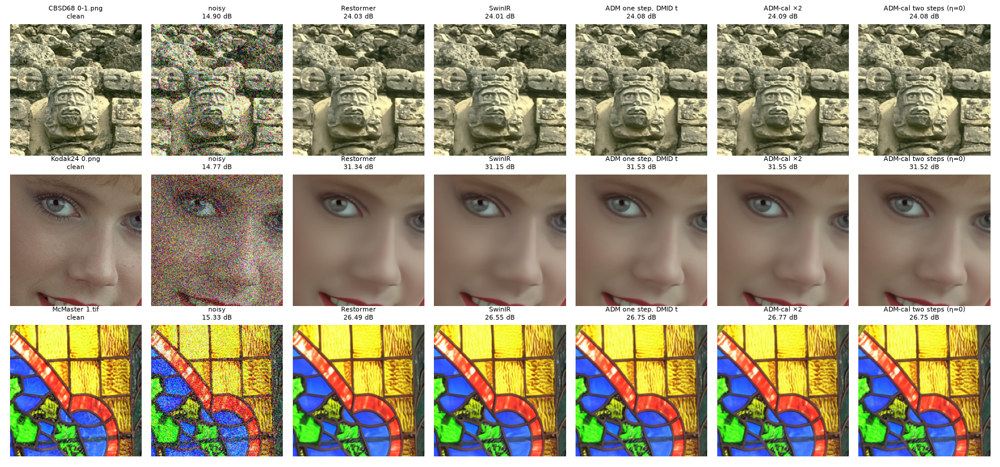

# One-step diffusion posterior mean on the standard Gaussian denoising benchmarks

Kaggle run [`trnquanghuyn/diffusion-tweedie-benchmark`](https://www.kaggle.com/code/trnquanghuyn/diffusion-tweedie-benchmark)
(private, 2× Tesla T4, 1 h 37 min) of
[`notebooks/diffusion_tweedie_benchmark.ipynb`](../../notebooks/diffusion_tweedie_benchmark.ipynb). Paired statistics:
[`analysis/diffusion_tweedie_benchmark.py`](../../analysis/diffusion_tweedie_benchmark.py).

DMID (Li et al., TPAMI 2024) holds the training-free state of the art in Gaussian colour denoising on CBSD68, Kodak24
and McMaster. It uses no denoising training. The frozen ADM 256×256 unconditional model gets the noisy image embedded at
the step whose noise level matches σ. DMID-d then averages 500 samples of its S_t = 2 chain. That chain evaluates the
network three times (N−1 → ⌊N/2⌋ → 0 → clean), so DMID-d costs 1500 network evaluations per image.

This study asks how much of that result one evaluation already gives, and whether training-free changes push it further.

**Bottom line.**

* **One evaluation nearly reproduces DMID-d.**
  * The one-step posterior mean (Tweedie's formula at the matched step) matches DMID-d at σ = 15. It trails by
    0.014 dB at σ = 25 and 0.031 dB at σ = 50 (Holm p < 0.001).
  * DMID's own ablation (§5.4.2) already reports that one step gives its best PSNR without repetitions, and that
    repetitions with 1 < S_t < 10 surpass it. This section re-measures that; it is not a new finding.
* **Training-free changes do not move the ceiling.**
  * A horizontal-flip average (two evaluations) halves the gap at σ = 50. ×2 is still 0.001–0.019 dB below DMID-d on
    every set at σ = 50.
  * Nothing else we tried moves it: a calibrated step, larger symmetry ensembles, a t → 0 → clean second step, tiling,
    or blending with Restormer/SwinIR.
  * DMID's own three-evaluation chain at η = 0 was not tried.
* **The ceiling is DMID-d's level, not above it.** The best variant, dihedral ×8, beats DMID-d's released outputs only
  at σ = 15 (+0.014 dB). It is level at σ = 25 and 0.024 dB behind at σ = 50 (Holm p = 0.003).
* **Against supervised networks, it wins on all 110 images.** It beats Restormer and SwinIR by 0.07–0.19 dB on every
  image at every level, at about Restormer's runtime.

## 1. Protocol and reproduction checks

* **Test sets:** CBSD68 (68), Kodak24 (24), McMaster (18) from DMID's release, at σ ∈ {15, 25, 50}.
* **Noise:** DMID's protocol. Gaussian noise is normalised to a sample standard deviation of exactly σ/255, added in
  floating point and never clipped. The seed is fixed per image and σ, so every method sees the same noisy image.
* **Inference:** the whole image, reflect-padded to a multiple of 64.
* **Metrics:** PSNR and SSIM on RGB uint8 outputs (SSIM as in skimage, Gaussian window σ = 1.5), and LPIPS (AlexNet).

Checks:

* **DMID's released outputs, rescored with our code,** reproduce its Table 1 to 0.005 dB in all nine cells (for
  example 28.7225 against 28.72 on CBSD68 at σ = 50).
* **Restormer, run by us** with the authors' σ-specific weights and padding, lands within 0.003–0.031 dB of its
  published numbers.
* **SwinIR, run the same way,** lands within 0.04 dB on CBSD68 and McMaster, except McMaster at σ = 25, and 0.11–0.15
  dB *above* its published Kodak24 numbers.
* **DRUNet matches its Kodak24 numbers** but is 0.06–0.36 dB below its CBSD68 and McMaster numbers. With the Gaussian
  SCUNet weights, the gaps are similar.
* Whatever the cause of these gaps, every comparison below uses identical inputs.
* **Numerics:** fp16 against fp32 ADM differs by 0.0001 dB on average. Memory-efficient attention
  (`scaled_dot_product_attention`) changes ε by at most 0.003.

## 2. Results

Mean PSNR (dB). Our rows use identical noisy inputs; the DMID-d row is its released outputs (different noise draws,
same images).

| | CBSD68 15 | 25 | 50 | Kodak24 15 | 25 | 50 | McMaster 15 | 25 | 50 |
|---|---:|---:|---:|---:|---:|---:|---:|---:|---:|
| DMID-d, released (1500 evaluations) | 34.452 | **31.860** | **28.722** | 35.506 | **33.117** | **30.139** | 35.716 | 33.491 | **30.500** |
| ADM one step, DMID's step (1) | 34.452 | 31.845 | 28.686 | 35.513 | 33.108 | 30.127 | 35.717 | 33.472 | 30.465 |
| ADM one step + h-flip, ×2 (2) | 34.462 | 31.858 | 28.703 | **35.522** | **33.117** | 30.138 | 35.734 | 33.493 | 30.487 |
| ADM one step, dihedral ×8 (8) | **34.463** | 31.857 | 28.692 | 35.518 | 33.109 | 30.118 | **35.748** | **33.508** | 30.497 |
| ADM two steps, η = 0 (2) | 34.429 | 31.832 | 28.682 | 35.488 | 33.092 | 30.121 | 35.695 | 33.459 | 30.460 |
| Restormer (σ-specific) | 34.391 | 31.764 | 28.569 | 35.473 | 33.044 | 30.016 | 35.597 | 33.327 | 30.278 |
| SwinIR (σ-specific) | 34.403 | 31.754 | 28.522 | 35.460 | 33.005 | 29.938 | 35.605 | 33.306 | 30.193 |

Published, for reference: MambaIR (ECCV 2024) 34.48 / – / 28.66, 35.42 / 32.99 / 29.92, 35.70 / 33.43 / 30.35. Hi-IR
(2024) gives 35.42 / 33.01 / 29.98 on Kodak24 and 35.69 / 33.44 / 30.42 on McMaster. The full table, with SSIM and
LPIPS, is [`means.csv`](means.csv).



## 3. What each training-free change does

Paired over the 110 images per σ ([`paired_tests.csv`](paired_tests.csv): bootstrap interval, sign-flip test with
200,000 patterns, Holm correction):

| contrast (PSNR, dB) | σ 15 | σ 25 | σ 50 |
|---|---:|---:|---:|
| one step − DMID-d (1500 evaluations) | +0.001 (n.s.) | −0.014 | −0.031 |
| continuous step − DMID's integer step | +0.000 | +0.001 | +0.001 |
| calibrated step − matched step | −0.000 | −0.000 | −0.000 |
| ×2 h-flip − ×1 | **+0.011** (110/110) | **+0.013** (109/110) | **+0.016** (109/110) |
| ×4 − ×2 | +0.002 | +0.002 (n.s.) | −0.003 (n.s.) |
| ×8 − ×4 | −0.000 (n.s.) | −0.002 (n.s.) | −0.007 |
| two steps (η = 0) − one step | −0.023 | −0.014 | −0.006 |
| 256-px tiles − whole image (Kodak24) | −0.014 (n.s.) | −0.033 | −0.072 |
| ×8 − DMID-d | +0.014 | −0.001 (n.s.) | −0.024 |
| ×8 − Restormer | +0.079 (109/110) | +0.101 (110/110) | +0.134 (110/110) |
| ×8 − SwinIR | +0.073 | +0.119 | +0.194 |

* **Calibration finds nothing to fix.** The start-step factor chosen on held-out DIV2K images is f̂ = 1.002–1.003,
  i.e. the matched step. Running 1–2 % below it costs far more than running above it, increasingly with σ
  ([`calibration.png`](calibration.png)).
* **Only the horizontal flip helps, and it is one of ADM's training symmetries.** Vertical flips and rotations are not,
  and adding them hurts at σ = 50 on CBSD68 and Kodak24 ([`ensemble.png`](ensemble.png)).
* **Blending adds at most 0.02 dB.** The ADM estimate was mixed with Restormer or SwinIR at a weight chosen on held-out
  images (0.7–0.9 on ADM). The largest gain is +0.017 dB (SwinIR, Kodak24, σ = 15), and a per-image oracle weight adds
  ≤ 0.002 dB more ([`fusion.csv`](fusion.csv)). The errors are too correlated.
* **The second step trades distortion for perception.** A t → 0 → clean step (two evaluations, run deterministically)
  lowers LPIPS on every image (−0.008, −0.010, −0.013) and costs 0.006–0.023 dB. It is not DMID's S_t = 2 chain, which
  has three evaluations.

## 4. Blind denoising (σ unknown)

The step is taken from a wavelet noise estimate σ̂ (`skimage.restoration.estimate_sigma`) times one multiplier m. The
multiplier is chosen on held-out DIV2K images: m̂ = 0.982.

* **Against Restormer's blind model:** level at σ = 15 (+0.006 dB, n.s.), +0.080 dB at σ = 25 and +0.086 dB at σ = 50.
* **Perception:** LPIPS is 0.035 lower at σ = 50 (107 of 110 images).
* **Cost of not knowing σ:** 0.087 / 0.026 / 0.049 dB against the non-blind step.

## 5. Cost

Seconds per image on one T4:

| | CBSD68 | Kodak24 | McMaster |
|---|---:|---:|---:|
| ADM one step | 0.77 | 1.69 | 1.03 |
| ADM ×2 | ≈ 1.5 | ≈ 3.4 | ≈ 2.1 |
| Restormer | 0.64 | 1.53 | 1.00 |
| SwinIR | 4.57 | 11.37 | 7.47 |

DMID-d's 1500 evaluations at the same cost per evaluation are about 1,150 s per CBSD68 image.

## 6. What this establishes

* The frozen ADM prior used as a one-step MMSE denoiser is within 0.03 dB of DMID-d on these three sets, as DMID's own
  ablation implies.
* The knobs tried add ≤ 0.02 dB at that level. Fine-tuning ADM on the denoising steps was tried next and also moved
  nothing ([`../adm_finetune`](../adm_finetune/README.md)).
* Not covered here: Urban100 (DMID-d's released outputs score 35.26 / 33.11 / 30.28; Hi-IR publishes 35.46 / 33.34 /
  30.59).

## Reproduce

```bash
kaggle kernels output trnquanghuyn/diffusion-tweedie-benchmark -p kaggle_output/sota/runA
python analysis/diffusion_tweedie_benchmark.py --run-output kaggle_output/sota/runA/outputs \
    --output-directory results/diffusion_benchmark
```

The notebook needs GPU T4 ×2 and internet; it downloads everything (ADM, DMID's test sets and released outputs,
DIV2K valid, and the baselines' weights from their authors' releases, with code pinned to commits). Use
`uvx --from kaggle --with six kaggle …` with the 2.2.5 wheel.

Files:

* **Copied from the run:** `scores.csv` (every method, image and σ), `dmid_released_scores.csv` and `summary.json`
  (calibrated factors, timings).
* **Written by the analysis script:** `means.csv`, `paired_tests.csv`, `calibration.csv`, `fusion.csv` and the three
  figures.
