# JEPA-guided diffusion denoising (Cách B): measured results

Artifacts and post-hoc analysis of the Kaggle run
([notebook](https://www.kaggle.com/code/trnquanghuyn/jepa-guided-diffusion),
private; finished 2026-11-03 17:00 UTC on 2× Tesla T4, torch 2.11).

Pipeline: noisy photo → denoising I-JEPA ViT-H/14 target encoder (output of
`jepa-denoise-finetune` v2) → LayerNormed 1280 × 16 × 16 latents → a
20.7 M-parameter adapter → added to the encoder features of a **frozen** ADM
256 × 256 unconditional model at 32, 16 and 8 px (blocks 9, 12, 15) and to its
time embedding. Denoising starts the reverse process from the noisy photo at
the matched step $t^*$. Every variant uses the same start and the same noise
draws:

| variant | isolates |
|---|---|
| ADM (Tweedie = one-step posterior mean at $t^*$; reverse = full chain) | the baseline (Cách A) |
| adapter, null latents ($c = 0$) | what DIV2K training alone changed |
| adapter, JEPA latents | the contribution of the JEPA information |

**Bottom line.** The JEPA latents do not improve denoising on any metric or
noise level. They are neutral on 15 of 16 images; on the other one they make
the chain under-denoise and cost 2.6 dB. The adapter does respond to its input,
but generation from pure noise shows it has not learned to carry the scene. The
setup also caps the possible gain: at test time the latents are a function of
the same noisy photo the chain starts from. Against standard denoisers, frozen
ADM is the best method at σ = 0.1, but SCUNet and Restormer beat every
diffusion variant at σ ≥ 0.2 (Section 7).

Two later experiments need no training.

* **Editing the adapter's weights by hand (Section 8) removes the failure.**
  Zeroing one 1024 × 1280 matrix, 6.3 % of the adapter, makes the JEPA model
  +0.014 dB better than null, on 14 of 16 images.
* **Choosing the start step from the noise actually present (Section 9)**
  gains 0.70 dB at σ = 0.3. It also gives one-step ADM the lowest LPIPS of
  every method tested, Restormer included.
* **Averaging 8 reverse samples cannot beat one-step Tweedie,** which already
  sits at the posterior mean.

## 1. Training stopped at 44 % of its budget; validation never separated

The 120-minute `TIME_BUDGET_MIN` stopped training at step **1,326 of 3,000**
(batch 8, so 10,608 crops; 5.4 s per step). The 3.4 h session split into
8 min of downloads, 120 min of training, 69.7 min of evaluation (52 cases) and
3.5 min of generation.

| step | ADM ε-MSE | null | JEPA | JEPA − null |
|---:|---:|---:|---:|---:|
| 0 | 0.042050 | 0.042049 | 0.042042 | −0.000007 |
| 250 | 0.042050 | 0.042019 | 0.042027 | +0.000008 |
| 500 | 0.042050 | 0.042046 | 0.042049 | +0.000003 |
| 750 | 0.042050 | 0.042002 | 0.042143 | +0.000141 |
| 1000 | 0.042050 | 0.042007 | 0.042109 | +0.000102 |
| 1250 | 0.042050 | 0.042012 | 0.042023 | +0.000011 |

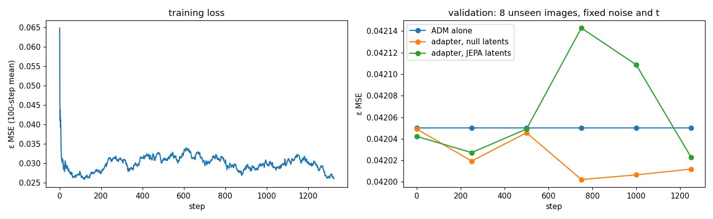

The notebook's own criterion ("JEPA below null = the adapter uses the JEPA
information") fails at 5 of 6 checkpoints. The training-loss panel is flat at
about 0.03 after roughly 50 steps. Its early drop from 0.065 is
`rolling(100, min_periods=1)` starting from a single 8-sample batch, not
learning.

This validation could not have shown conditioning anyway. With $\hat x_0$
derived from $\hat\varepsilon$, the identity
$\lVert\varepsilon-\hat\varepsilon\rVert^2 = \mathrm{SNR}(t)\,\lVert x_0-\hat x_0\rVert^2$
holds exactly, with $\mathrm{SNR}(t)=\bar\alpha_t/(1-\bar\alpha_t)$:

| validation $t$ | 30 | 60 | 120 | 200 | 300 | 500 | 700 | 900 |
|---|---:|---:|---:|---:|---:|---:|---:|---:|
| SNR | 80.4 | 23.0 | 5.89 | 1.91 | 0.650 | 0.0844 | 0.00692 | 0.00027 |

The latents can only add information at low SNR, where $x_t$ has lost the
layout. There, an improvement in $\hat x_0$ shrinks 12–3,700-fold before it
reaches ε-MSE. At high SNR, $x_t$ already shows the scene.

## 2. Denoising: neutral on 15 of 16 images, harmful on one

Inputs: 16 DIV2K validation images (0801–0816, centre 256 crop) at Gaussian
σ ∈ {0.1, 0.2, 0.3}, plus 4 PolyU real-noise pairs. Start steps are
$t^*$ = 57 / 117 / 170 (SNR 25 / 6.2 / 2.8), and 8–16 (SNR 226–618) for the
real pairs. Mean PSNR (dB) / LPIPS:

| method | σ 0.1 | σ 0.2 | σ 0.3 | real camera |
|---|---:|---:|---:|---:|
| noisy input | 20.32 / 0.424 | 14.83 / 0.849 | 11.98 / 1.133 | 32.43 / 0.131 |
| ADM Tweedie | 31.04 / 0.061 | 26.40 / 0.173 | 22.77 / 0.307 | 33.19 / 0.075 |
| ADM reverse | 28.56 / 0.052 | 24.89 / 0.124 | 22.39 / 0.243 | 32.94 / 0.086 |
| adapter null: reverse | 28.62 / 0.052 | 24.90 / 0.125 | 22.39 / 0.241 | 32.95 / 0.086 |
| adapter JEPA: Tweedie | 31.01 / 0.062 | 26.40 / 0.173 | 22.77 / 0.308 | 33.20 / 0.075 |
| adapter JEPA: reverse | 28.47 / 0.062 | 24.76 / 0.138 | 22.37 / 0.251 | 32.90 / 0.087 |

Paired differences per image. Intervals are 95 % paired bootstrap. p is an
exact sign-flip test, Holm-corrected within each contrast. With n = 16 the
smallest possible p is 3.1e−5; with n = 4 it is 0.125, so the real-camera rows
can never be significant.

| contrast | condition | Δ PSNR (dB) [95 % CI] | better on | Holm p | Δ LPIPS [95 % CI] |
|---|---|---:|---:|---:|---:|
| JEPA − null (reverse) | σ 0.1 | −0.150 [−0.496, +0.044] | 8/16 | 1 | +0.010 [−0.001, +0.032] |
| | σ 0.2 | −0.138 [−0.481, +0.046] | 10/16 | 1 | +0.013 [−0.001, +0.038] |
| | σ 0.3 | −0.027 [−0.124, +0.026] | 13/16 | 1 | +0.010 [+0.002, +0.022] |
| | real | −0.051 [−0.092, −0.008] | 1/4 | 1 | +0.001 [−0.002, +0.003] |
| null − ADM (reverse) | σ 0.1 | +0.052 [+0.023, +0.106] | 16/16 | 4.6e−4 | +0.000 [−0.000, +0.001] |
| | Gaussian, per image | +0.023 [+0.012, +0.041] | 16/16 | 4.6e−4 | −0.000 [−0.002, +0.001] |
| JEPA − ADM (Tweedie) | Gaussian, per image | −0.011 [−0.053, +0.013] | 13/16 | 1 | +0.001 [−0.001, +0.002] |
| Tweedie − reverse (ADM) | σ 0.1 | +2.475 [+2.315, +2.625] | 16/16 | 4.6e−4 | +0.009 [+0.005, +0.014] |
| | σ 0.2 | +1.502 [+1.295, +1.710] | 16/16 | 4.6e−4 | +0.049 [+0.037, +0.061] |
| | σ 0.3 | +0.384 [+0.271, +0.503] | 15/16 | 6.1e−4 | +0.064 [+0.039, +0.091] |

All rows, including SSIM and the remaining conditions, are in
[`paired_tests.csv`](paired_tests.csv).

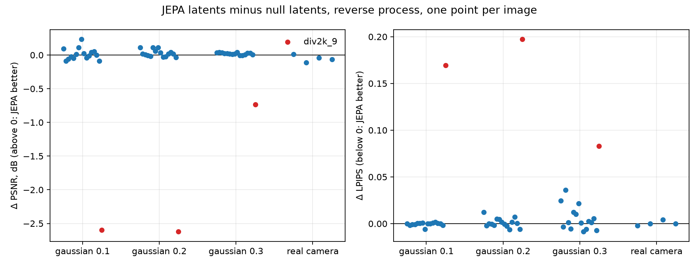

The mean JEPA effect is carried by one image. **div2k_9** (DIV2K 0810: a grey
squirrel on a rock against smooth green bokeh; well exposed, ImageNet-like
content) loses 2.60 / 2.62 / 0.73 dB and gains 0.17 / 0.20 / 0.08 LPIPS. The
other 15 images stay within ±0.25 dB; the median over all 16 is −0.007 /
+0.018 / +0.019 dB. The damage builds up along the chain:

| div2k_9 PSNR (dB) | ADM Tweedie | JEPA Tweedie | ADM reverse | null reverse | JEPA reverse |
|---|---:|---:|---:|---:|---:|
| σ 0.1 | 31.13 | 30.64 | 28.48 | 28.49 | 25.90 |
| σ 0.2 | 27.66 | 27.48 | 25.57 | 25.58 | 22.96 |
| σ 0.3 | 24.51 | 24.23 | 23.69 | 23.69 | 22.95 |

The run saved outputs only for its three gallery cases. A re-run that saves
every output (Section 7) shows the JEPA-conditioned chain leaving grain on this
image.

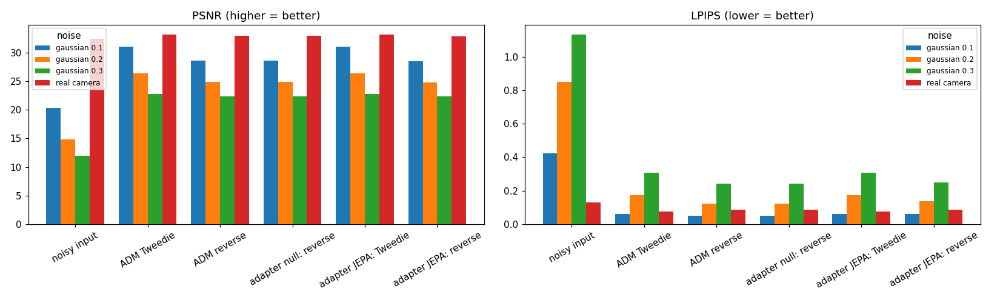
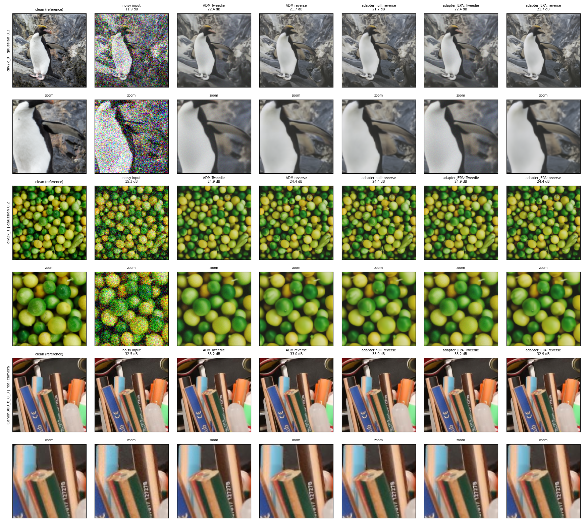

## 3. Generation from pure noise: the latents do not carry the scene

This is DDIM with 50 steps from $t = 999$, conditioned on the JEPA latents of
σ = 0.2 noisy photos, with the same start noise per seed. The output is set by
the seed. With seed 0, four unrelated photos (penguin, limes, flower, rodeo
crowd) give nearly the same image, which is close to the null-latent one.
Seed 1 gives a different image, again shared across all four photos.

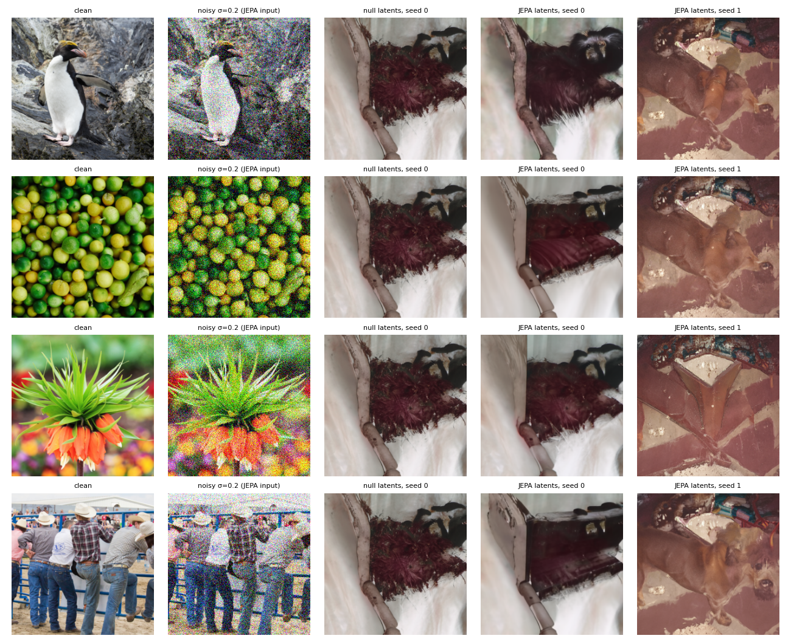

## 4. The adapter is not inert: it injects, but nothing useful

From [`diagnostics.json`](diagnostics.json), with the adapter rebuilt from the
notebook and loaded from `jepa_adapter.pt`:

| injection | output-layer weight RMS | null-latent output RMS | change for random LayerNormed latents |
|---|---:|---:|---:|
| block 9 (32 px, 512 ch) | 0.0040 | 0.271 | 0.20–0.24 (0.73–0.89 × null) |
| block 12 (16 px, 512 ch) | 0.0035 | 0.609 | 0.26–0.30 (0.42–0.50 × null) |
| block 15 (8 px, 1024 ch) | 0.0032 | 2.111 | 0.86–0.93 (0.41–0.44 × null) |
| time embedding | 0.0029 | 0.0076 | 0.002–0.066 |

* The zero-initialised output layers reached RMS 3–4 × 10⁻³, about 15 % of a
  default initialisation (0.018–0.026).
* With null latents every branch adds a spatially constant per-channel offset
  (interior spatial std 0). That is a learned bias, consistent with the
  +0.05 dB null-versus-ADM gain.
* Random latents move the injected features by 40–90 % of that offset, so the
  output depends on its input. Two things are not measured here: how far apart
  real JEPA latents of different photos are (that needs the 632 M-parameter
  encoder), and how large these offsets are relative to ADM's own activations
  at those blocks.

## 5. Tweedie versus reverse sampling

One-step Tweedie wins PSNR at every noise level. The full reverse chain wins
LPIPS on Gaussian noise, which is the perception–distortion trade-off. An exact
posterior sample has exactly twice the MSE of the exact posterior mean
($\mathbb E\lVert x-\tilde x\rVert^2 = 2\,\mathrm{MMSE}$, a 3.01 dB gap). The
measured MSE ratio, reverse / Tweedie (geometric mean over images), is:

| σ 0.1 | σ 0.2 | σ 0.3 | real |
|---:|---:|---:|---:|
| 1.77 | 1.41 | 1.09 | 1.06 |

A ratio far below 2 at σ ≥ 0.2 means one of two things, or both: the one-step
estimate is far from the posterior mean there, or the chain's samples are
under-dispersed. Averaging several reverse samples per image would tell them
apart.

Evaluation caveat: `add_gaussian` clamps to [0, 1]. At σ = 0.3 that clips
15–19 % of pixels (measured on images 0801 and 0810), and the residual std is
0.255–0.262 rather than 0.3, so $t^*$ is chosen for more noise than the image
has. This affects every variant equally. It shifts absolute numbers, not the
JEPA comparison. Section 9 measures it and settles the ratio question.

## 6. Why the latents cannot help much here

1. **No new information at test time.** $c = \mathrm{JEPA}(y)$ and
   $x_{t^*} = \sqrt{\bar\alpha_{t^*}}(2y-1)$ are both functions of the same
   noisy photo $y$. So $\mathbb E[x_0 \mid x_{t^*}, c] = \mathbb E[x_0 \mid x_{t^*}]$,
   and the Bayes-optimal denoiser is unchanged. The latents can only help as a
   better feature of $y$ than ADM computes itself.
2. **Trained on a different observation.** In training,
   $c = \mathrm{JEPA}(\mathrm{synthesize}(y))$ is an independent corruption of
   the clean crop, and 20 % of the time the clean crop itself. It therefore
   carried information that $x_t$ lacked, which never happens at inference.
   The div2k_9 failure is consistent with the adapter trusting the latents as
   a cleaner view [inference].
3. **The objective barely rewards using $c$.** ε-MSE weights $x_0$ errors by
   SNR. The low-SNR steps where $c$ is informative are down-weighted
   12–3,700-fold, and `P_FOCUS = 0.5` draws half of every batch from $t < 300$.
4. **Budget.** 10,608 crops for a 20.7 M-parameter adapter.

## 7. Against standard denoisers, with every output saved

[`notebooks/jepa_denoise_comparison.ipynb`](../../notebooks/jepa_denoise_comparison.ipynb)
(Kaggle `trnquanghuyn/jepa-denoise-comparison`, private, 2× T4, 36 min)
rebuilds the 52 evaluation inputs; their noisy-input PSNR matches this run to
4e−15 dB. For 19 cases (div2k 0, 1, 2, 3 and 9 at every σ, plus the 4 real
pairs) it re-runs the five diffusion variants with the same seeds. Their scores
match `scores.csv` to 7e−15 dB, so the saved images are this run's own outputs.
Four standard denoisers run on all 52 cases:

| model (weights) | kind | told the noise level |
|---|---|---|
| BM3D (`bm3d_rgb`) | classical collaborative filtering | yes |
| DRUNet (`drunet_color`) | CNN with a noise-level map, trained on σ ≤ 50/255 | yes |
| Restormer (`gaussian_color_denoising_blind`) | transformer, blind, trained on σ ≤ 50/255 | no |
| SCUNet (`scunet_color_real_psnr`) | swin-conv UNet, blind, trained for real camera noise | no |

For the real pairs, "told the noise level" means std(noisy − clean), the same
value that sets the diffusion start step. Mean PSNR (dB) / LPIPS over all 52
cases:

| method | σ 0.1 | σ 0.2 | σ 0.3 | real camera |
|---|---:|---:|---:|---:|
| ADM Tweedie | 31.04 / 0.061 | 26.40 / 0.173 | 22.77 / 0.307 | 33.19 / 0.075 |
| ADM reverse | 28.56 / 0.052 | 24.89 / 0.124 | 22.39 / 0.243 | 32.94 / 0.086 |
| adapter JEPA: reverse | 28.47 / 0.062 | 24.76 / 0.138 | 22.37 / 0.251 | 32.90 / 0.087 |
| BM3D | 29.87 / 0.111 | 25.76 / 0.268 | 22.82 / 0.406 | 33.28 / 0.057 |
| DRUNet | 30.84 / 0.074 | 26.40 / 0.206 | 23.07 / 0.354 | 33.61 / 0.054 |
| Restormer | 30.90 / 0.060 | 26.57 / 0.125 | 23.59 / 0.189 | 32.43 / 0.131 |
| SCUNet | 30.52 / 0.081 | 27.46 / 0.166 | 25.58 / 0.251 | 32.52 / 0.056 |

Paired PSNR difference to ADM Tweedie, in dB, with the 95 % interval and the
number of images on which the standard denoiser is better. Every entry has
Holm p ≤ 0.036 except the two marked n.s.; all rows are in
[`standard_denoisers_tests.csv`](standard_denoisers_tests.csv).

| vs ADM Tweedie | σ 0.1 | σ 0.2 | σ 0.3 |
|---|---:|---:|---:|
| BM3D | −1.17 [−1.43, −0.95] 0/16 | −0.63 [−0.83, −0.47] 0/16 | +0.05 [−0.07, +0.16] 11/16 n.s. |
| DRUNet | −0.20 [−0.27, −0.13] 1/16 | +0.01 [−0.07, +0.09] 7/16 n.s. | +0.29 [+0.23, +0.35] 16/16 |
| Restormer | −0.14 [−0.19, −0.10] 1/16 | +0.17 [+0.13, +0.22] 16/16 | +0.82 [+0.75, +0.88] 16/16 |
| SCUNet | −0.51 [−0.85, −0.20] 4/16 | +1.07 [+0.70, +1.48] 15/16 | +2.81 [+2.40, +3.26] 16/16 |

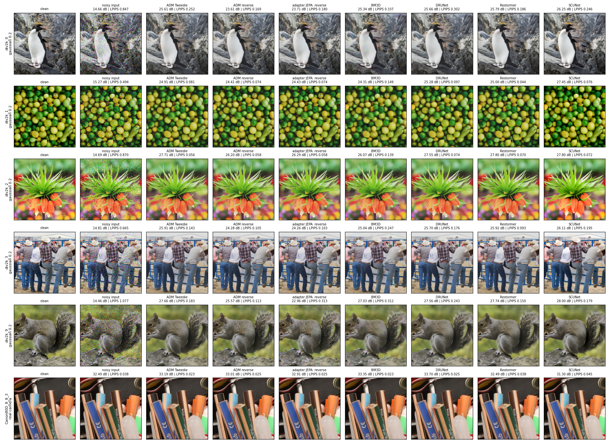
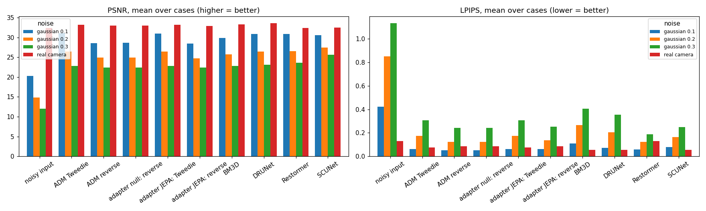

**Reading.**

* **σ = 0.1: ADM is the best denoiser here.** Tweedie has the highest PSNR,
  and all four standard denoisers are significantly lower. The reverse chain
  has the lowest LPIPS (0.052); Restormer, at 0.060, is worse on 12 of 16
  images.
* **σ ≥ 0.2: the standard denoisers take over.** SCUNet leads on PSNR by
  +1.07 / +2.81 dB. Restormer ties ADM reverse on LPIPS at σ = 0.2 and beats
  it at σ = 0.3 (0.189 vs 0.243, better on 14 of 16 images).
* **Why the blind models gain at σ = 0.3.** The clipped noise is weaker than
  its nominal σ (residual std 0.255–0.262, Section 5). Only the blind models
  can adapt to that; ADM's $t^*$, DRUNet and BM3D are all told 0.3.
* **Real camera** (4 pairs; no test can reach significance at n = 4). DRUNet
  is best (33.61 dB, LPIPS 0.054), and ADM Tweedie (33.19) is close to BM3D
  (33.28). Restormer's blind Gaussian model returns these inputs unchanged.
  Every method keeps 63–100 % of the noisy − clean difference on these crops,
  and much of that difference may not be removable noise, because the
  reference is a mean of many shots [inference].

**The div2k_9 failure, now visible.** The JEPA-conditioned chain leaves fine
colour grain over the whole image, while ADM and the null adapter, which use
the same start and noise draws, come out clean:

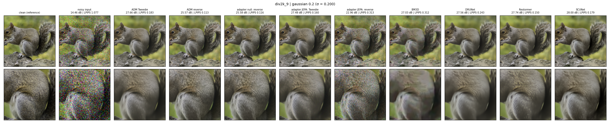

[`retained_noise.csv`](retained_noise.csv) gives the share of the input noise
left in each output (least-squares coefficient of output − clean on
noisy − clean):

| div2k_9 | ADM reverse | null reverse | JEPA reverse | ADM Tweedie | JEPA Tweedie |
|---|---:|---:|---:|---:|---:|
| σ 0.1 | 0.076 | 0.075 | 0.180 | 0.079 | 0.145 |
| σ 0.2 | 0.037 | 0.037 | 0.090 | 0.010 | 0.032 |

On the other four re-run images, JEPA and ADM keep the same share to within
0.006. Retained input noise explains only 23 % (σ 0.1) and 10 % (σ 0.2) of
the extra squared error. The rest is grain uncorrelated with the input noise,
which the chain adds at every step and here fails to remove. On this image the
latents push the noise estimate down: the chain under-denoises rather than
hallucinating content [the mechanism is inference; the grain is measured].

More cases: [penguin at σ = 0.3](comparison/div2k-0__gaussian-0-3.png),
[real camera, Canon 80D](comparison/canon80d-8-8-3200-ball-1__real-camera.png).
All 19 grids and every output PNG are in the Kaggle output.

## 8. Weight-space programming: editing the adapter by hand

This section follows *Sparks of Weight-Space Programming* (Takehi et al.,
2026). The adapter was edited directly from a reading of its weights plus a
small budget of forward-pass probes, with no training and no gradients:

* probes: [`notebooks/jepa_adapter_weight_probe.ipynb`](../../notebooks/jepa_adapter_weight_probe.ipynb);
* reading: [`analysis/jepa_adapter_weights.py`](../../analysis/jepa_adapter_weights.py),
  which writes [`weight_reading.json`](weight_reading.json);
* edits and their evaluation on the 52 cases:
  [`notebooks/jepa_adapter_weight_edits.ipynb`](../../notebooks/jepa_adapter_weight_edits.ipynb).

**Reading the weights.** The four output layers have effective rank 13–18
(spatial branches, 512–1,024 wide) and 41 (`glob`). Their top singular
direction is almost exactly the constant null-latent offset (cosine
0.84–0.95). So most of what 1,326 steps learned is a fixed DIV2K offset, and
the latent-dependent part lives in a few other directions.

**Probes.** These used 40 DIV2K images (16–55, outside the evaluation set) at
σ ∈ {0.1, 0.2}, scored by one-step Tweedie, with one adapter path at a time
switched to the JEPA latents and the rest held at null
([`weight_space/probe_tweedie.csv`](weight_space/probe_tweedie.csv)):

| paths on JEPA latents (σ 0.1) | Δ kept vs null, mean | worst image |
|---|---:|---:|
| all (the JEPA variant) | +0.0010 | +0.0075 |
| `glob` only | +0.0016 | +0.0076 |
| spatial branches only | −0.0005 | +0.0019 |
| block 12 or block 15 only | ≈ 0 | ≤ +0.0005 |

The `glob` path alone carries the noise-keeping. Full chains on the 4 worst
held-out cases agree: on image 48, JEPA keeps 0.197 of the input noise,
`glob` only 0.198, spatial only 0.183 and null 0.184.

**What the `glob` change is.** These numbers are from `weight_reading.json`.

* 87 % of the latent-induced change Δg = g(c) − g(0) is the same vector for
  every image.
* Only 0.05 % of Δg lies along the time-embedding tangent (a timestep shift of
  −1.4 to +0.6 steps), so it is not a plain change of perceived noise level.
* Its image-specific part does not predict Δkept on held-out images: R² ≤ 0.13
  with 1–6 principal components, and a leave-one-image-out correlation of
  0.14.

**Two edits.** Both leave the null-latent output exactly unchanged.

| edit | tensor | weights changed | change |
|---|---|---:|---|
| E2 | `glob.0.weight` (1024×1280) | 1.31 M (6.3 %) | set to 0: `glob` ignores the latents |
| E3 | `glob.2.weight` (1024×1024) | 1.05 M (5.1 %), rank 1 | W₂ ← W₂ − m vᵀ: removes the common offset (81 % of it on held-out halves), keeps the image-specific part |

**Result on the 52 cases.** These ran with v1's inputs and seeds; the re-run
matches v1 to 0.0001 dB. Mean reverse PSNR (dB)
([`weight_space/edits_scores.csv`](weight_space/edits_scores.csv)):

| reverse chain | σ 0.1 | σ 0.2 | σ 0.3 | real camera |
|---|---:|---:|---:|---:|
| ADM | 28.563 | 24.893 | 22.388 | 32.942 |
| null | 28.615 | 24.903 | 22.394 | 32.953 |
| JEPA, original | 28.466 | 24.764 | 22.367 | 32.902 |
| **JEPA, E2** | **28.632** | **24.919** | **22.404** | 32.935 |
| JEPA, E3 | 28.485 | 24.770 | 22.356 | 32.935 |

The div2k_9 failure, as PSNR change against null:

| div2k_9, Δ PSNR vs null (dB) | σ 0.1 | σ 0.2 | σ 0.3 |
|---|---:|---:|---:|
| JEPA, original | −2.60 | −2.62 | −0.73 |
| JEPA, E2 | −0.04 | −0.06 | −0.02 |
| JEPA, E3 | −2.72 | −2.83 | −0.86 |

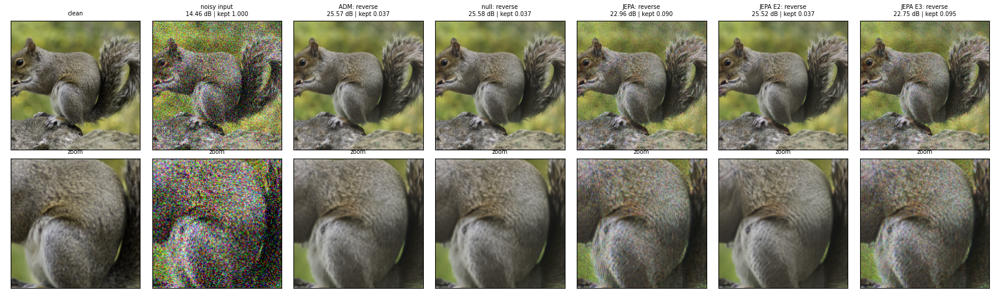
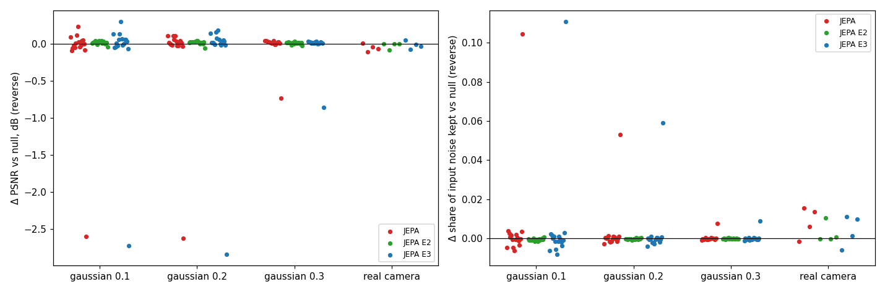

Paired tests ([`weight_edit_tests.csv`](weight_edit_tests.csv)), E2 − null:

* per level: +0.017 / +0.017 / +0.010 dB, better on 13 / 13 / 12 of 16 images;
* pooled over the Gaussian levels: +0.014 dB [+0.005, +0.022], better on 14 of
  16 images, Holm p = 0.074.

E2 costs a little LPIPS at σ = 0.3 (0.252 against null's 0.241): its remaining
spatial branches smooth slightly.

**Reading.**

* **E2 removes the failure entirely.** The worst extra noise kept falls from
  +0.104 to +0.0007.
* **E2 makes the JEPA model the best diffusion reverse variant,** by a small
  but consistent margin over null. That margin is what the spatial branches
  contribute.
* **E3 localises the mechanism.** The damage comes from the `glob` path's
  image-specific response to div2k_9's latents, not from the common offset.
  The held-out probes could not show this, because no held-out image triggered
  it.
* **As in the blog's Gemma experiment, the edit removes an obstacle; it does
  not add information** (Section 6).

## 9. Inference-only fixes: start step from the image, mean of 8 samples

[`notebooks/adm_noise_level_and_averaging.ipynb`](../../notebooks/adm_noise_level_and_averaging.ipynb)
(Kaggle `trnquanghuyn/adm-noise-level-and-averaging`, private, 2× T4, 2.6 h)
reran plain ADM (no adapter) on the same 52 cases and seeds. The inputs match
v1 to 4·10⁻¹⁵ dB and the Tweedie outputs to 0.0002 dB. It tests two changes
that need no training:

1. choose the start step $t^*$ from the noise actually in the image instead
   of the nominal σ, either the oracle residual std $\mathrm{std}(y - x)$ or a
   blind estimate σ̂ (wavelet MAD, `skimage.restoration.estimate_sigma`);
2. average $K = 8$ reverse samples started from $t^*(\hat\sigma)$.

DRUNet and BM3D also get σ̂, so the comparison stays fair.

**Clipping lowers the noise present** ([`noise_level/noise_levels.csv`](noise_level/noise_levels.csv)):

| mean (range) | σ 0.1 | σ 0.2 | σ 0.3 | real camera |
|---|---:|---:|---:|---:|
| residual std | 0.096 | 0.181 | 0.251 | 0.024 |
| σ̂, blind | 0.097 (0.088–0.101) | 0.177 (0.161–0.188) | 0.245 (0.225–0.263) | 0.003 |

σ̂ tracks the residual within 6 % on synthetic noise. It fails on real camera
noise, which is spatially correlated: at 0.003 it sets $t^* = 0$.

**Tweedie start-step sweep**, mean PSNR in dB
([`noise_level/tweedie_sweep.csv`](noise_level/tweedie_sweep.csv)). For real
camera, "σ" is the pair's residual std, which v1 already used.

| start step from | σ 0.1 | σ 0.2 | σ 0.3 | real camera |
|---|---:|---:|---:|---:|
| 0.8 × σ | 27.78 | 23.67 | 22.60 | 32.91 |
| 0.9 × σ | 30.01 | 26.20 | 23.44 | 33.06 |
| σ (v1) | **31.04** | 26.40 | 22.77 | 33.19 |
| 1.15 × σ | 29.99 | 25.17 | 21.70 | **33.42** |
| residual std (oracle) | 31.01 | **26.45** | **23.48** | 33.19 |
| σ̂ (blind) | 30.93 | 26.09 | 23.10 | 32.49 |

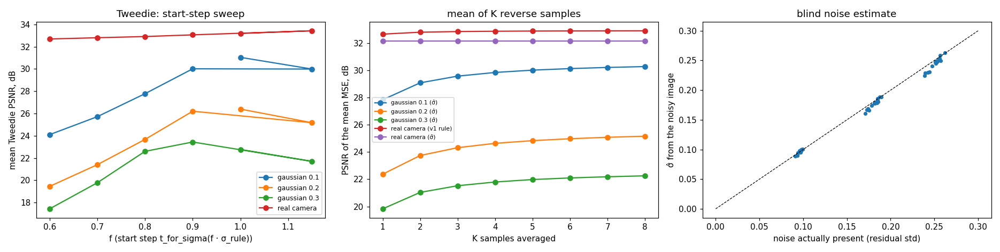

Paired against the v1 rule ([`improvement_tests.csv`](improvement_tests.csv)),
per level σ 0.1 / 0.2 / 0.3:

* **oracle residual std:** PSNR −0.03 / +0.05 / **+0.70 dB** (σ 0.3 better on
  16 of 16 images, Holm p = 5·10⁻⁴); LPIPS −0.007 / −0.057 / −0.133, better on
  15–16 of 16, Holm p ≤ 6·10⁻⁴;
* **blind σ̂:** PSNR −0.11 / −0.31 / +0.33 dB (pooled −0.03, not significant);
  LPIPS −0.005 / −0.046 / −0.104 (pooled −0.051, better on 15 of 16, Holm
  p = 9·10⁻⁴).

σ̂ loses PSNR against the oracle only where it underestimates. It is below the
residual on 32 of the 48 Gaussian cases (by up to 6 %), and each 1 % below
costs ≈ 0.17 dB (correlation 0.91–0.94 per level). Overestimates of up to 2.6 %
cost nothing (+0.008 dB). The worst case is div2k_1 at σ = 0.2: σ̂ is 0.94× the
residual and loses 1.11 dB.

**Mean of K reverse samples**, started from $t^*(\hat\sigma)$
([`noise_level/mse_by_k.csv`](noise_level/mse_by_k.csv)). The MSE is fitted as
$a + b/k$; $a$ is the error of the sampler's posterior mean.

| | single sample / posterior mean | Tweedie / posterior mean | mean of 8 − Tweedie (σ̂) |
|---|---:|---:|---:|
| σ 0.1 | 1.97 | 1.01 | −0.47 dB, 0/16 better |
| σ 0.2 | 2.18 | 0.98 | −0.70 dB, 0/16 better |
| σ 0.3 | 1.95 | 0.97 | −0.60 dB, 0/16 better |

* From a start that matches the noise, single samples have twice the
  posterior-mean MSE, as exact posterior samples should, and one-step Tweedie
  already sits at the posterior mean.
* So averaging approaches Tweedie from below and cannot pass it.
* The averaging ran only from the σ̂ start. Section 5's ratios below 2 at the
  nominal start most likely come from that start overstating the noise; they
  were not re-measured there.

**Fair comparison**, with σ̂ given to every σ-conditioned method (mean PSNR /
LPIPS; bold = best in the column):

| | σ 0.1 | σ 0.2 | σ 0.3 |
|---|---:|---:|---:|
| ADM Tweedie, σ̂ start | 30.93 / 0.056 | 26.09 / 0.128 | 23.10 / 0.204 |
| ADM Tweedie, oracle start (needs the clean image) | **31.01** / **0.054** | 26.45 / **0.116** | 23.48 / **0.175** |
| DRUNet (σ̂) | 30.82 / 0.063 | 26.35 / 0.129 | 23.39 / 0.202 |
| BM3D (σ̂) | 29.85 / 0.102 | 25.89 / 0.214 | 23.09 / 0.307 |
| Restormer (blind) | 30.90 / 0.060 | 26.57 / 0.125 | 23.59 / 0.189 |
| SCUNet (blind) | 30.52 / 0.081 | **27.46** / 0.166 | **25.59** / 0.251 |

* **With the oracle start,** one-step ADM has the lowest LPIPS of every method
  at every Gaussian level. Against Restormer: pooled −0.010, better on 15 of
  16, Holm p = 0.005, at equal PSNR (pooled −0.04 dB, not significant).
* **With σ̂,** ADM ties DRUNet (σ̂) and Restormer on LPIPS at σ ≥ 0.2, trails
  them by 0.26–0.49 dB PSNR, and beats SCUNet on LPIPS at every level.
* **σ̂ helps DRUNet and BM3D too:** pooled LPIPS −0.080 and −0.054; PSNR
  +0.33 and +0.26 dB at σ = 0.3.
* **SCUNet still leads PSNR at σ ≥ 0.2,** by 1.0–2.5 dB.
* **Real camera:** σ̂ switches every σ-conditioned method off; ADM Tweedie
  gives 32.49 dB against the noisy input's 32.43. From the pair's residual std,
  the best ADM start is 1.15× (33.42 dB) and the mean of 8 equals Tweedie
  (33.18). DRUNet with the pair's σ stays best (33.61).

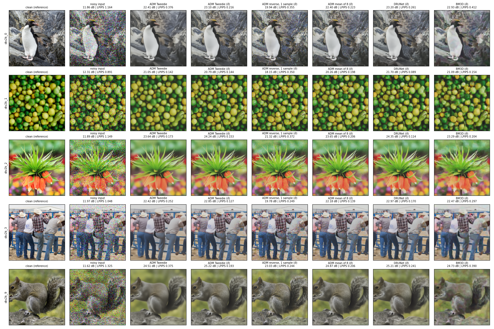

**Reading.**

* **The first fix works, and its value is mostly perceptual.** A start step
  matched to the noise present stops one-step ADM from over-smoothing.
* **The blind estimate keeps the LPIPS gain but not the PSNR.** Its error is
  one-sided (underestimation), so the estimator is now the bottleneck.
* **The second fix is ruled out** by the 1/K fit.

**Follow-up: σ̂ biased upward.** This was run in `diffusion-tweedie-benchmark` (section 9 of
[`notebooks/diffusion_tweedie_benchmark.ipynb`](../../notebooks/diffusion_tweedie_benchmark.ipynb); continuous start
step, uint8 outputs, so absolute numbers differ slightly from the table above).

* One multiplier m on σ̂ was chosen on DIV2K images 0817–0856, the weight probe's held-out set:
  m̂ = 1.086 ([`noise_level/clipped_calibration.csv`](noise_level/clipped_calibration.csv)).
* The 48 Gaussian cases were then scored once
  ([`noise_level/clipped_scores.csv`](noise_level/clipped_scores.csv)).

| one-step ADM, mean PSNR / LPIPS | σ 0.1 | σ 0.2 | σ 0.3 |
|---|---:|---:|---:|
| step from σ̂ | **30.93** / **0.056** | 26.07 / **0.128** | 23.10 / **0.204** |
| step from 1.086 σ̂ | 30.84 / 0.077 | **26.56** / 0.149 | **23.46** / 0.223 |
| step from the residual std (oracle) | 31.00 / 0.053 | 26.46 / 0.116 | 23.47 / 0.176 |

* **PSNR:** the multiplier gains +0.49 dB at σ = 0.2 (13 of 16 images, sign-flip p = 0.003) and +0.36 dB at σ = 0.3
  (12 of 16, p = 0.008). It loses 0.09 dB at σ = 0.1 (n.s.).
* **Against the oracle start:** it reaches it in PSNR at σ ≥ 0.2.
* **LPIPS:** it costs 0.02 at every level (σ = 0.1: 15 of 16 images worse).
* **Trade-off:** the PSNR-optimal start over-smooths. Most of σ̂'s PSNR deficit was the estimator's bias, but the
  same bias was helping perception.

## 10. What is and is not established

Established for this checkpoint, these 16 + 4 images and this sampler:

* JEPA latents do not beat null latents or plain ADM on PSNR, SSIM or LPIPS at
  any noise level, and on div2k_9 they cost 2.6 dB;
* the null adapter improves ADM by a consistent but negligible +0.05 dB at
  σ = 0.1;
* the adapter's output depends on its input, but pure-noise generation does
  not follow the scene in the latents;
* one-step Tweedie maximises PSNR at every level and already sits at the
  sampler's posterior mean, so averaging reverse samples cannot beat it (the
  mean of 8 loses 0.47–0.70 dB on every image); from v1's start, reverse
  sampling gives lower LPIPS on Gaussian noise;
* on div2k_9 the JEPA latents make the chain under-denoise: it keeps 2.4× more
  of the input noise and leaves extra grain;
* frozen ADM is the best of these denoisers at σ = 0.1, and SCUNet leads PSNR
  at σ ≥ 0.2 by 1.0–2.5 dB. Restormer's LPIPS lead holds only against v1's
  start: with $t^*$ matched to the noise present, one-step ADM has the lowest
  LPIPS of every method at every Gaussian level;
* clipping leaves 0.96 / 0.91 / 0.84 of the nominal σ. Choosing $t^*$ from the
  noise present gains 0.70 dB at σ = 0.3 (16 of 16 images) and lowers LPIPS at
  every level. The blind σ̂ keeps the LPIPS gain (pooled −0.051) but loses
  0.31 dB at σ = 0.2, all through underestimation;
* the noise-keeping failure lives in the adapter's `glob` path: zeroing
  `glob.0.weight` (6.3 % of the adapter, no training) removes it and leaves
  the JEPA model +0.014 dB above null (better on 14 of 16 images, Holm p = 0.074).

Not established:

* that JEPA latents cannot help with a full budget, a matched training signal
  or a different objective;
* why the `glob` path responds to div2k_9's latents the way it does (the
  response is image-specific and was not triggered by any held-out probe image);
* anything about real camera noise beyond 4 pairs;
* a blind noise estimate as good as the oracle start, and any working estimate
  for real camera noise (σ̂ 0.003 against a residual of 0.024).

Next controlled changes, in order:

1. build $c$ from the same trajectory the chain starts from, so that training
   matches inference, and drop `P_CLEAN`. This is prepared in
   [`notebooks/jepa_guided_diffusion_matched.ipynb`](../../notebooks/jepa_guided_diffusion_matched.ipynb)
   but not run;
2. validate with $x_0$-MSE per timestep (or the generation test) instead of
   mean ε-MSE;
3. retrain with `glob` blind to the latents (edit E2), since the spatial
   branches are the part that helps;
4. ~~bias σ̂ upward~~ done (end of Section 9): +0.36 to +0.49 dB at σ ≥ 0.2, at a
   cost of 0.02 LPIPS. Real camera noise still needs an estimator for
   correlated noise.

## Reproduce

```bash
kaggle auth login     # or KAGGLE_API_TOKEN / ~/.kaggle/access_token
kaggle kernels output trnquanghuyn/jepa-guided-diffusion -p kaggle_output/jepa-guided-diffusion/output
kaggle kernels output trnquanghuyn/jepa-denoise-comparison -p kaggle_output/denoise-comparison/output
kaggle kernels output trnquanghuyn/adm-noise-level-and-averaging -p kaggle_output/adm-noise-level/output
kaggle kernels output trnquanghuyn/jepa-adapter-weight-probe -p kaggle_output/wsp-probe/output
kaggle kernels output trnquanghuyn/jepa-adapter-weight-edits -p kaggle_output/wsp-edits/output
python analysis/jepa_guided_diffusion.py \
    --kaggle-output kaggle_output/jepa-guided-diffusion/output/outputs \
    --comparison-output kaggle_output/denoise-comparison/output/outputs \
    --improvement-output kaggle_output/adm-noise-level/output/outputs \
    --edits-output kaggle_output/wsp-edits/output/outputs \
    --output-directory results/jepa_guided_diffusion
python analysis/jepa_adapter_weights.py \
    --kaggle-output kaggle_output/jepa-guided-diffusion/output/outputs \
    --probe-output kaggle_output/wsp-probe/output/outputs \
    --output-directory results/jepa_guided_diffusion
```

To re-run the comparison, run
[`notebooks/jepa_denoise_comparison.ipynb`](../../notebooks/jepa_denoise_comparison.ipynb)
on Kaggle with GPU T4 ×2 and internet on, and attach the outputs of
`jepa-denoise-finetune` (v2) and `jepa-guided-diffusion` (v1). With the CLI,
push a folder holding the notebook and a `kernel-metadata.json` whose
`kernel_sources` lists both. `DIFFUSION_IMAGES` chooses which images also run
the slow diffusion variants, at about 4.5 min per image for the three σ.

The later notebooks run the same way on GPU T4 ×2 with internet on, with these
kernel sources attached:

| notebook | kernel sources | time |
|---|---|---:|
| [`adm_noise_level_and_averaging`](../../notebooks/adm_noise_level_and_averaging.ipynb) | `jepa-guided-diffusion`, `jepa-denoise-comparison` | 2.6 h |
| [`jepa_adapter_weight_probe`](../../notebooks/jepa_adapter_weight_probe.ipynb) | `jepa-denoise-finetune`, `jepa-guided-diffusion` | 11 min |
| [`jepa_adapter_weight_edits`](../../notebooks/jepa_adapter_weight_edits.ipynb) | the probe's two, plus `jepa-adapter-weight-probe` | 1.8 h |

The `kaggle` 2.2.5 wheel is missing its `six` dependency; run it as
`uvx --from kaggle --with six kaggle …`.

Where each file comes from:

* **Copied from the original run:** `results.json`, `scores.csv` and the
  `training`, `scores`, `gallery` and `generation` figures.
* **`comparison/`:** the comparison run's `all_scores.csv`,
  `diffusion_rerun_scores.csv`, `summary.json`, `overview.png`, `metrics.png`
  and three of its 19 per-case grids.
* **`noise_level/`:** the noise-level run's `all_scores.csv`,
  `tweedie_sweep.csv`, `noise_levels.csv`, `mse_by_k.csv`, `summary.json`,
  `sweep_and_k.png` and its σ = 0.3 grid.
* **`weight_space/`:** from the probe run, `probe_tweedie.csv` and
  `probe_chain.csv`. From the edits run, its `scores.csv`, `summary.json` and
  `per_image.png`, renamed with an `edits_` prefix, plus the div2k_9 grid.
* **Written by the analysis scripts:** `paired_tests.csv`, `per_image.csv`,
  `standard_denoisers_tests.csv`, `retained_noise.csv`, `diagnostics.json`,
  `improvement_tests.csv`, `weight_edit_tests.csv` and `jepa_minus_null.png`,
  plus `weight_reading.json` from `analysis/jepa_adapter_weights.py`.
* **Left in the Kaggle outputs:** the 79 MB adapter checkpoint, the edited
  adapters E2 and E3 (`edited_adapters.pt`, 158 MB), the probe latents
  (`latents.pt`), the kernel logs, the other grids and the per-method PNGs
  (`images/<case>/NN-<method>.png`).
