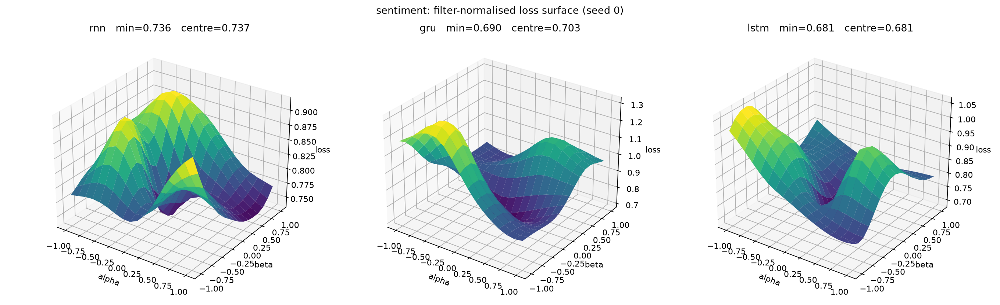
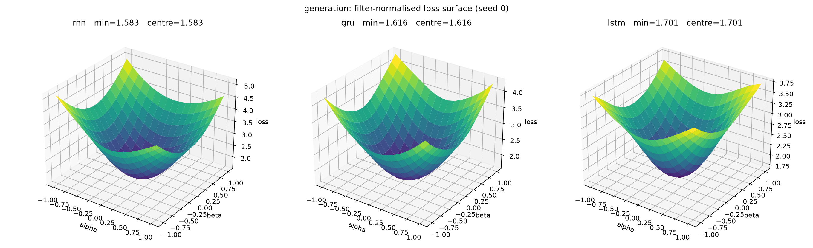
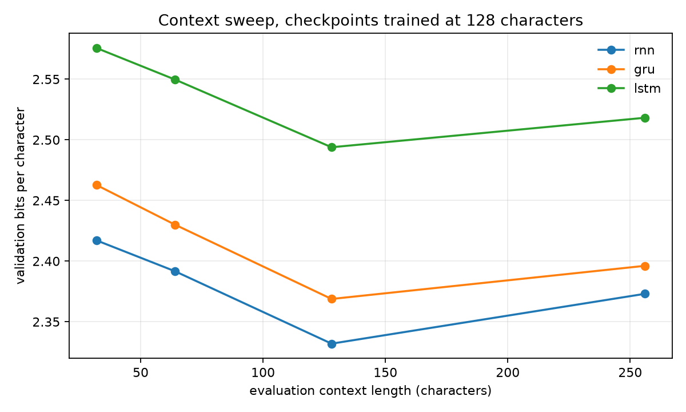
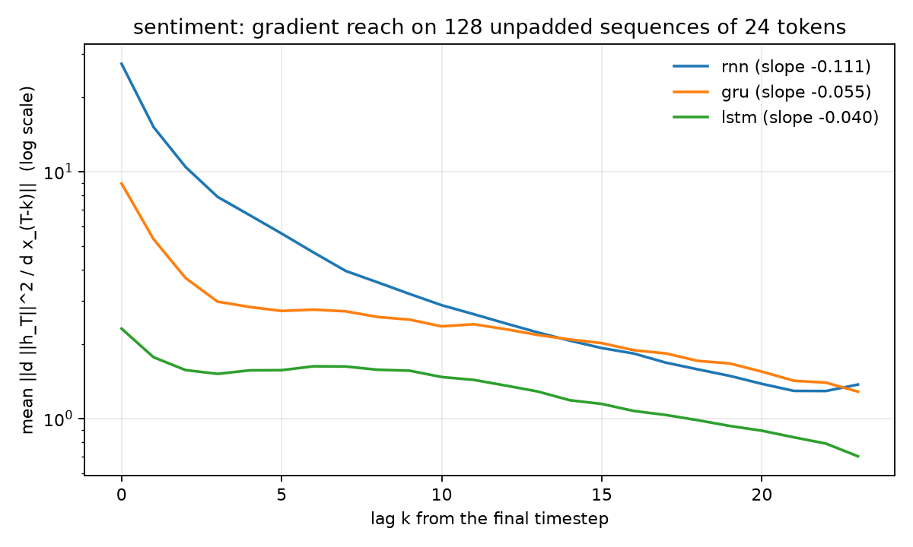
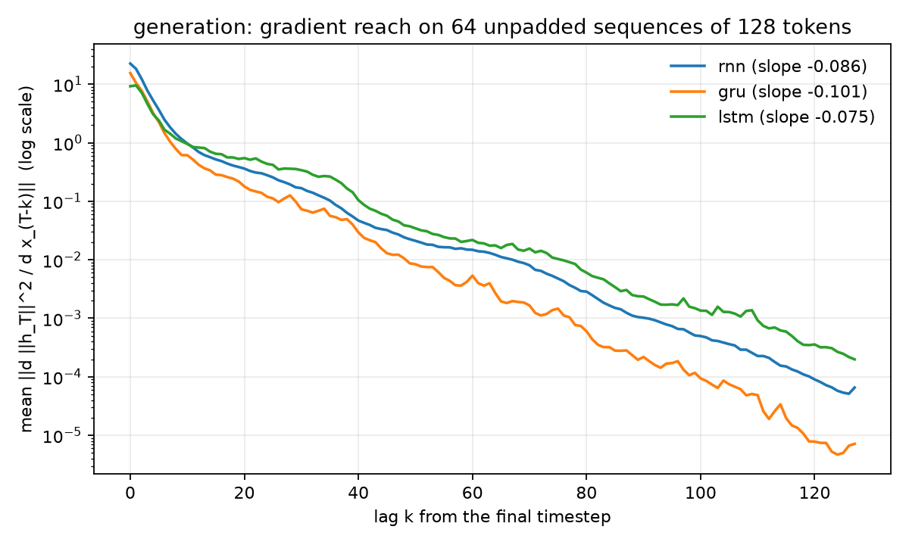

# RNN vs GRU vs LSTM: measured results

Two tasks, three cells, one parameter budget. This directory holds the artifacts
produced by the Kaggle GPU run
([notebook](https://www.kaggle.com/code/trnquanghuyn/rnn-gru-lstm-comparison))
of the two experiments:

* `experiments/sequence_classification/sentiment/`
* `experiments/language_modeling/recurrent_generation/`

A detailed, self-contained HTML report (Vietnamese, interactive charts and 3-D
surfaces, works offline) is [`report.html`](report.html); rebuild it with
`python analysis/build_report.py`. Every number in it is computed from the
files in this directory.

Configuration shared by both tasks: 3 cells × 3 seeds, identical data,
optimiser (AdamW), cosine schedule, batch size and optimizer-step budget. The
embedding and the cell are sized by solving

$$
P_{\text{cell}}(H) = m\,(IH + H^2 + 2H), \qquad m = 1,3,4
$$

for the hidden size closest to a shared target (2.0 M parameters for sentiment,
1.5 M for generation). The LSTM therefore receives fewer hidden units than the
RNN at the same total parameter count.

## 1. Sentiment classification (SST-2)

2.0 M parameters, a 20 000-example train pool (18 000 after the validation
split), 1 500 optimizer steps, batch 64,
max length 64. Test set: the 872-example SST-2 dev split.

| cell | hidden | parameters | accuracy (mean ± std) | NLL | gradient slope λ (seed 0) |
|---|---:|---:|---:|---:|---:|
| RNN | 1158 | 2,000,190 | 0.6743 ± 0.0105 | 0.7486 | −0.1106 |
| GRU | 655 | 1,998,557 | **0.7393 ± 0.0037** | 0.6985 | −0.0551 |
| LSTM | 563 | 1,998,116 | **0.7393 ± 0.0134** | 0.7162 | −0.0399 |

Per-seed accuracy:

| cell | seed 0 | seed 1 | seed 2 |
|---|---:|---:|---:|
| RNN | 0.6720 | 0.6651 | 0.6858 |
| GRU | 0.7408 | 0.7351 | 0.7420 |
| LSTM | 0.7248 | 0.7420 | 0.7511 |

Pairwise tests:

| pair | Δ accuracy | 95 % paired-bootstrap CI | McNemar p | Holm p | 95 % seed-level t CI |
|---|---:|---|---:|---:|---|
| RNN − GRU | −0.0650 | [−0.0872, −0.0420] | 2.39e−4 | 7.17e−4 | [−0.0840, −0.0460] |
| RNN − LSTM | −0.0650 | [−0.0856, −0.0443] | 2.34e−3 | 4.68e−3 | [−0.0949, −0.0351] |
| GRU − LSTM | 0.0000 | [−0.0153, +0.0149] | 0.2467 | 0.2467 | [−0.0347, +0.0347] |


**Reading.** Gated cells beat the vanilla RNN by 6.5 accuracy points; every
interval excludes zero. GRU and LSTM are indistinguishable: their difference is
exactly zero on the seed average, both the example-level and seed-level
intervals include zero, and McNemar agrees. The gap appears in every length
bucket:


From the 8–15 to the 32–64 token bucket (seed-averaged, per example) the RNN
loses 10.3 points, the GRU 7.6 and the LSTM 6.0. All three degrade on long
sentences and the RNN degrades fastest, but the longest bucket holds only 125
sentences (0.8 points each), so this is a trend, not a test. This experiment
does not isolate which gate does the work.

Full report: [`sentiment/report.md`](sentiment/report.md).

## 2. Character-level generation (Tiny Shakespeare)

1.5 M parameters, 8.192 M training tokens per run (2 000 steps × batch 32 ×
block 128), character vocabulary of 65. Metric: bits per character on the
validation tail; lower is better.

| cell | hidden | parameters | validation BPC (mean ± std) | gradient slope λ (seed 0) |
|---|---:|---:|---:|---:|
| RNN | 1159 | 1,499,335 | **2.3842 ± 0.0075** | −0.0863 |
| GRU | 664 | 1,501,545 | 2.4065 ± 0.0055 | −0.1015 |
| LSTM | 572 | 1,501,149 | 2.5463 ± 0.0149 | −0.0750 |

Per-seed BPC:

| cell | seed 0 | seed 1 | seed 2 |
|---|---:|---:|---:|
| RNN | 2.3883 | 2.3888 | 2.3755 |
| GRU | 2.4117 | 2.4008 | 2.4071 |
| LSTM | 2.5348 | 2.5411 | 2.5631 |

Pairwise tests (negative Δ BPC favours the first cell):

| pair | Δ BPC | 95 % window-bootstrap CI | bootstrap p | 95 % seed-level t CI |
|---|---:|---|---:|---|
| RNN − GRU | −0.0223 | [−0.0254, −0.0192] | < 0.001 | [−0.0468, +0.0022] |
| RNN − LSTM | −0.1622 | [−0.1674, −0.1570] | < 0.001 | [−0.2175, −0.1068] |
| GRU − LSTM | −0.1398 | [−0.1434, −0.1361] | < 0.001 | [−0.1809, −0.0988] |

A bootstrap p of exactly 0 over 2 000 resamples only says p < 0.001.


The hidden-size ratios follow directly from the parameter accounting:

$$
\frac{H_{\mathrm{GRU}}}{H_{\mathrm{RNN}}}
= \frac{664}{1159} = 0.573 \approx \frac{1}{\sqrt{3}},
\qquad
\frac{H_{\mathrm{LSTM}}}{H_{\mathrm{RNN}}}
= \frac{572}{1159} = 0.494 \approx \frac{1}{2}.
$$

This is what matching $P \approx mH^2$ forces; it is arithmetic, not a
performance theorem.

**Reading.** The RNN reaches the lowest validation BPC, but its lead over the
GRU is not stable across seeds: the stricter seed-level interval
[−0.0468, +0.0022] includes zero. The LSTM is clearly worse: its seed-level
interval is entirely above zero, and its BPC is worse in every seed. The
likely mechanism is capacity allocation, not optimisation: matching *total*
parameters forces hidden sizes 1159 / 664 / 572, so the LSTM has roughly half
the state width of the RNN, while the 128-character context may be short enough
that gating buys little. This experiment therefore does **not** show that RNNs
are better next-token models in general; it shows that, at this budget and
context length, the extra gate parameters cost more than they return.

Samples (same prompt, temperature and sampling seed per cell; full file
[`generation/samples.txt`](generation/samples.txt)):

```text
RNN:  By not her lady lood more soldiep / Is the many their senatation ...
GRU:  By noble have wellow me in the eppess. / ROMEO: Now, Lond Carrown ...
LSTM: By not her you marces, / Till lobe her fauthth of not menalance ...
```

Full report: [`generation/report.md`](generation/report.md).


## 3. 3-D loss surfaces: local geometry, not a general proof

Each panel is the surface

$$
\theta(\alpha,\beta)=\theta_0+\alpha\delta_1+\beta\delta_2
$$

around one trained checkpoint (seed 0), with filter-normalised random
directions $\delta_1,\delta_2$ ($\delta_2$ orthogonalised against $\delta_1$
per tensor) and a 17×17 grid over $[-1,1]^2$. Loss is cross-entropy (nats) on
the first four unshuffled batches of the **evaluation** split: 512 SST-2 dev
sentences, 64 validation windows of 128 characters.

| task | cell | min | centre | max |
|---|---|---:|---:|---:|
| sentiment | RNN | 0.7361 | 0.7368 | 0.9178 |
| sentiment | GRU | 0.6904 | 0.7027 | 1.3201 |
| sentiment | LSTM | 0.6811 | 0.6811 | 1.0627 |
| generation | RNN | 1.5830 | 1.5830 | 5.1410 |
| generation | GRU | 1.6163 | 1.6163 | 4.3056 |
| generation | LSTM | 1.7014 | 1.7014 | 3.7636 |




**What this shows.** On generation every checkpoint is the lowest point of its
slice. On sentiment it is not for the RNN and GRU (grid minima at
$(\alpha,\beta)=(-0.125,0)$ and $(0.125,-0.125)$): the loss is measured on the
evaluation split, not the training split, so the trained point need not be its
minimum. The rise from the centre to the grid maximum is smallest for the RNN
on sentiment (0.18 versus 0.38 LSTM and 0.62 GRU) and for the LSTM on
generation (2.06 versus 2.69 GRU and 3.56 RNN): in both tasks the flattest
surface belongs to the worst model. Three points per task cannot establish a
correlation, the rise over a ±1 box is not a curvature, and sharpness changes
under reparameterisations that leave the function unchanged (Dinh et al.,
2017), so the surfaces explain neither the 6.5-point sentiment gap nor the BPC
gap.

**What this cannot show.** A surface is a property of **one trained point** and
**two random directions**. It is not a statement about the task distribution,
and no collection of 3-D slices can prove “architecture A generalises better”.
That would require a bound over a task class, or a counterexample showing the
ordering flips. The surfaces are diagnostics of the local geometry around one
solution, not evidence that one cell is universally better.

## 4. Context sweep: does the ordering change with regime?

The generation checkpoints were trained at 128 characters. Evaluating the seed-0
checkpoints on the first non-overlapping validation windows of 32, 64, 128 and
256 characters (up to 32 batches × 16 windows; at 256 that is the whole
validation split, 435 windows; BPC per character) gives:

| context | RNN | GRU | LSTM |
|---:|---:|---:|---:|
| 32 | **2.4171** | 2.4627 | 2.5757 |
| 64 | **2.3917** | 2.4301 | 2.5497 |
| 128 | **2.3319** | 2.3688 | 2.4939 |
| 256 | **2.3730** | 2.3961 | 2.5182 |



The RNN < GRU < LSTM ordering is stable over this range at the shared parameter
budget. Within a row the three cells see identical characters; across rows both
the length and the text change (16,384 to 111,360 characters), so the column
trend mixes the two. Two further boundary conditions matter: the models were
trained at 128, so 256 is extrapolation; and “context” here is evaluation window
length, not a different training budget. This is stronger evidence than a
single point, but still evidence for one corpus, one budget and one training
length — not a general theorem.

### What a general proof would require

A general statement has the form: for every task distribution in a class
$\mathcal{D}$, budget $B$ and tolerance $\epsilon$, method A needs fewer
resources than B, or a matching lower bound rules B out. A loss surface cannot
supply that because it fixes one $\theta$, one data sample and two directions.
The defensible claim from these experiments is conditional:

> At the tested parameter budget, data and context lengths, gated cells
> significantly beat a parameter-matched RNN on SST-2; on character-level
> Shakespeare the RNN has the lowest BPC, but its advantage over the GRU is not
> stable across seeds, while the LSTM gap is.

A falsifier for the capacity-allocation explanation is a width-matched
comparison (same $H$ rather than same $P$) and training at each context length
(not only evaluating at it). If LSTM still loses at width-matched, long-context
training, the explanation is incomplete.

## 5. Gradient reach: what the corrected probe shows

> **Correction.** The first version of this section reported slopes of
> −0.133 / −0.130 / −0.128 (sentiment) and −0.0115 / −0.0114 / −0.0113
> (generation) and concluded that reach does not order the cells. Those numbers
> came from a broken probe: it differentiated with respect to a stacked copy of
> the outputs that is not connected to earlier hidden states, so every timestep
> but the last had zero gradient and the "slope" only reflected the sequence
> length. The probe now differentiates with respect to the inputs of unpadded
> sequences and is tested against the analytic slope of a linear RNN.
> Accuracy, BPC and every statistical test are unaffected.

`analysis/gradient_reach.py` measures $g(k)=\mathbb{E}\,\lVert\partial\lVert h_T\rVert^2/\partial x_{T-k}\rVert$
on the seed-0 checkpoints (sentiment: 128 dev sentences cut to 24 tokens;
generation: 64 validation windows of 128 characters) and fits
$\log g(k)\approx a+\lambda k$. The carry factor is what multiplies the gradient
on the direct path each step: $\tanh'$ for the RNN, $z$ for the GRU, $f$ for the
LSTM.

| task | cell | λ | $e^{\lambda}$ per step | g(8)/g(0) | g(16)/g(0) | mean carry factor | carry > 0.9 |
|---|---|---:|---:|---:|---:|---:|---:|
| sentiment | RNN | −0.1106 | 0.895 | 0.130 | 0.067 | 0.663 | 30.2 % |
| sentiment | GRU | −0.0551 | 0.946 | 0.288 | 0.211 | 0.487 | 0.31 % |
| sentiment | LSTM | −0.0399 | 0.961 | 0.681 | 0.464 | 0.505 | 0.074 % |
| generation | RNN | −0.0863 | 0.917 | 0.063 | 0.022 | 0.426 | 15.6 % |
| generation | GRU | −0.1015 | 0.903 | 0.050 | 0.018 | 0.142 | 4.0 % |
| generation | LSTM | −0.0750 | 0.928 | 0.128 | 0.069 | 0.535 | 15.7 % |




* **Sentiment:** the gated cells keep the final state sensitive to inputs much
  further back (LSTM > GRU > RNN), consistent with their accuracy advantage,
  although GRU and LSTM tie on accuracy despite different reach.
* **Generation:** the LSTM reaches furthest but has the worst BPC, and after
  64 characters every cell retains under 0.2 % of its sensitivity. Reach does not
  explain this ordering; capacity allocation (1159 / 664 / 572 hidden units)
  remains the more plausible explanation.
* **Theory versus measurement:** the trained RNNs have
  $\sigma_{\max}(W_{hh})$ = 2.57 and 4.18, so the sufficient condition for
  vanishing gradients ($\sigma_{\max}<1$) does not hold, yet sensitivity still
  falls 8–11 % per step.
* **Gates are not near 1:** mean forget/update gates sit near 0.5. A counting
  bound shows that for a direct carry path to retain at least $e^{\lambda}$ per
  step, the gate must exceed 0.9 on at least a $1-\lambda/\ln 0.9$ fraction of
  steps; with the observed fractions, at most 0.12 % (LSTM) and 0.67 % (GRU) of
  (unit, sentence) pairs on sentiment can do so. Most long-lag sensitivity must
  therefore travel through the recurrent matrices, unless it concentrates on
  those few pairs. On generation the bound is too loose to conclude anything.
  The models were trained without a forget-gate bias of 1, a confound for the
  next experiment.

## 6. What is and is not established

Established, conditional on this data, budget and seeds:

* GRU and LSTM significantly outperform a parameter-matched RNN on SST-2
  accuracy; GRU and LSTM are statistically indistinguishable;
* at 1.5 M parameters and a 128-character context, a parameter-matched RNN
  achieves lower validation BPC than a GRU or LSTM, but only the LSTM gap is
  stable across seeds;
* measured gradient reach (seed 0) orders the cells as gated > RNN on
  sentiment, matching accuracy, but does not explain the generation ordering.

Not established:

* a universal ordering of RNN, GRU and LSTM;
* that gating is useless at longer contexts or larger budgets;
* that validation BPC on Tiny Shakespeare transfers to natural text at scale.

The next controlled variation is width-matched rather than parameter-matched
capacities, and a context length sweep (32 / 128 / 512) to find where reach
starts to matter.

## Reproduce

```bash
python data/prepare_sst2.py
python experiments/sequence_classification/sentiment/run.py --tier development --device cuda
python experiments/language_modeling/recurrent_generation/run.py --tier development --device cuda

# post-hoc analysis of the checkpoints
python -m pip install -e ".[analysis]"
python analysis/gradient_reach.py --task sentiment --run-directory runs/sequence_classification/sentiment/development --output-directory results/recurrent_comparison/reach
python analysis/gradient_reach.py --task generation --run-directory runs/language_modeling/recurrent_generation/development --output-directory results/recurrent_comparison/reach
# random directions depend on the device's generator; these surfaces were computed on CUDA
python analysis/loss_landscape.py --task sentiment --run-directory runs/sequence_classification/sentiment/development --output-directory results/recurrent_comparison/landscapes --device cuda --extra-seeds 1 2 3 4
python analysis/loss_landscape.py --task generation --run-directory runs/language_modeling/recurrent_generation/development --output-directory results/recurrent_comparison/landscapes --device cuda --extra-seeds 1 2 3 4
python analysis/context_sweep.py --run-directory runs/language_modeling/recurrent_generation/development --output-directory results/recurrent_comparison/contexts

# the HTML report (Python 3.12+)
python analysis/build_report.py
```

or run [`notebooks/recurrent_comparison.ipynb`](../../notebooks/recurrent_comparison.ipynb)
on a Kaggle GPU. Raw per-example predictions and per-window losses remain in
the Kaggle run output; this directory stores the reports and figures.
