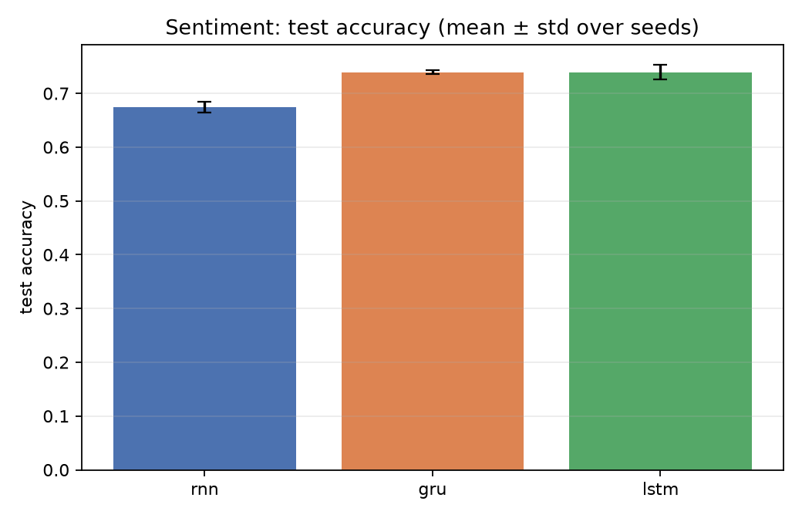
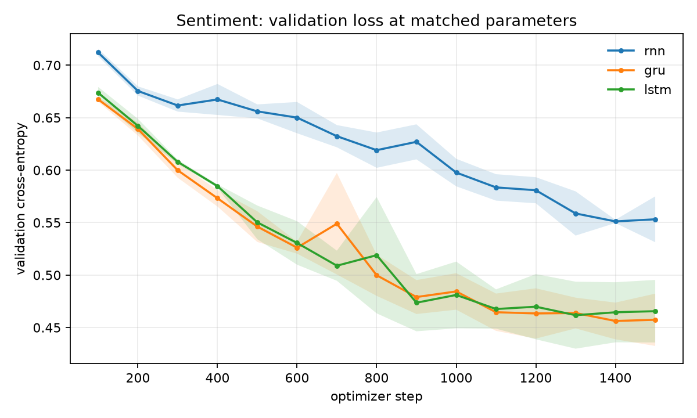
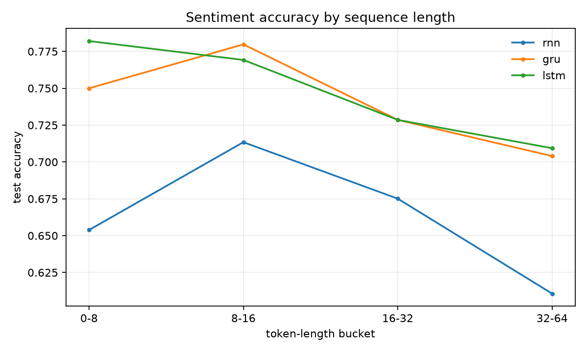
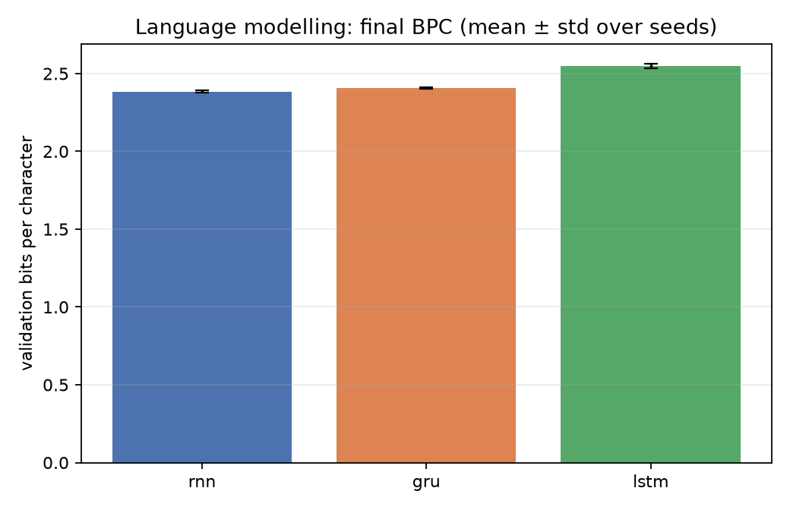
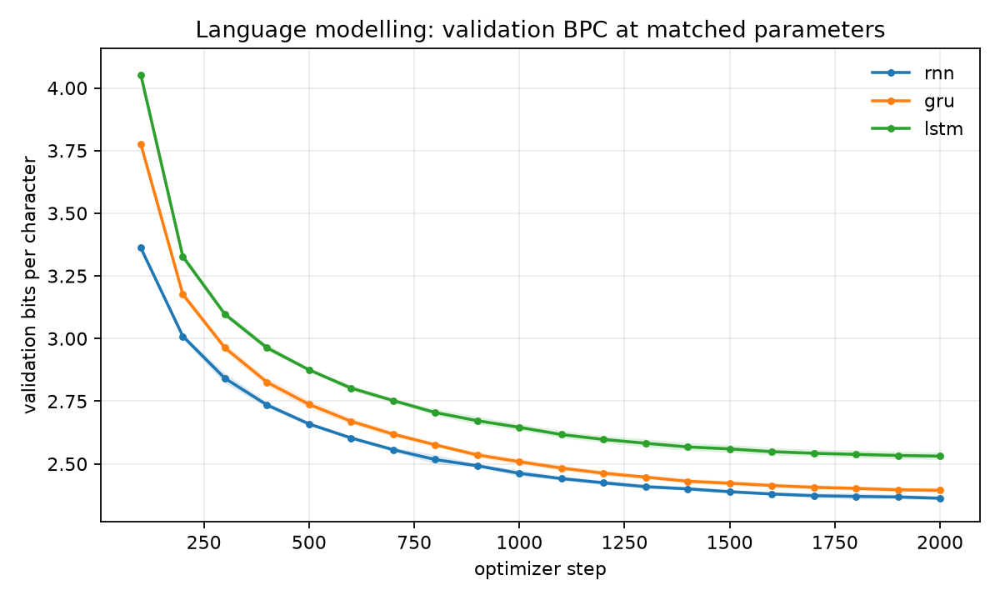
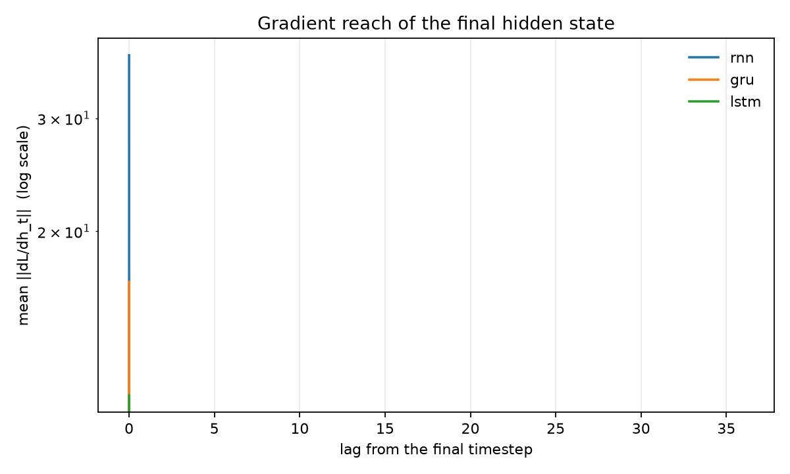
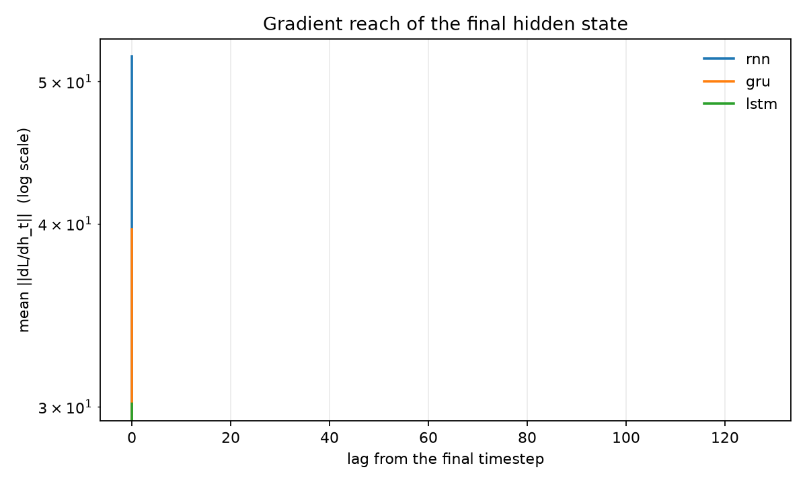

# RNN vs GRU vs LSTM: measured results

Two tasks, three cells, one parameter budget. This directory holds the artifacts
produced by the Kaggle GPU run
([notebook](https://www.kaggle.com/code/trnquanghuyn/rnn-gru-lstm-comparison))
of the two experiments:

* `experiments/sequence_classification/sentiment/`
* `experiments/language_modeling/recurrent_generation/`

Configuration shared by both tasks: 3 cells × 3 seeds, identical data,
optimiser (AdamW), cosine schedule, batch size and optimizer-step budget. The
embedding and the cell are sized by solving

$$
P_{\text{cell}}(H) = m\,(IH + H^2 + 2H), \qquad m = 1,3,4
$$

for the hidden size closest to a shared target (2.0 M parameters for sentiment,
1.5 M for generation). The LSTM therefore receives fewer hidden units than the
RNN at the same total parameter count.

## 1. Sentiment classification (SST-2)

2.0 M parameters, a 20 000-example train pool (18 000 after the validation
split), 1 500 optimizer steps, batch 64,
max length 64. Test set: the 872-example SST-2 dev split.

| cell | hidden | parameters | accuracy (mean ± std) | NLL | gradient slope |
|---|---:|---:|---:|---:|---:|
| RNN | 1158 | 2,000,190 | 0.6743 ± 0.0105 | 0.7486 | −0.13333 |
| GRU | 655 | 1,998,557 | **0.7393 ± 0.0037** | 0.6985 | −0.12982 |
| LSTM | 563 | 1,998,116 | **0.7393 ± 0.0134** | 0.7162 | −0.12789 |

Per-seed accuracy:

| cell | seed 0 | seed 1 | seed 2 |
|---|---:|---:|---:|
| RNN | 0.6720 | 0.6651 | 0.6858 |
| GRU | 0.7408 | 0.7351 | 0.7420 |
| LSTM | 0.7248 | 0.7420 | 0.7511 |

Pairwise tests:

| pair | Δ accuracy | 95 % paired-bootstrap CI | McNemar p | Holm p | 95 % seed-level t CI |
|---|---:|---|---:|---:|---|
| RNN − GRU | −0.0650 | [−0.0872, −0.0420] | 2.39e−4 | 7.17e−4 | [−0.0840, −0.0460] |
| RNN − LSTM | −0.0650 | [−0.0856, −0.0443] | 2.34e−3 | 4.68e−3 | [−0.0949, −0.0351] |
| GRU − LSTM | 0.0000 | [−0.0153, +0.0149] | 0.2467 | 0.2467 | [−0.0347, +0.0347] |





**Reading.** Gated cells beat the vanilla RNN by 6.5 accuracy points; every
interval excludes zero. GRU and LSTM are indistinguishable: their difference is
exactly zero on the seed average, both the example-level and seed-level
intervals include zero, and McNemar agrees. The advantage is concentrated in
longer sentences:



The RNN loses about 4 points between the 8–16 and 32–64 token buckets; GRU and
LSTM stay within 1–2 points. That is consistent with gates helping when the
label depends on a longer span, but this experiment does not isolate which gate
does the work.

Full report: [`sentiment/report.md`](sentiment/report.md).

## 2. Character-level generation (Tiny Shakespeare)

1.5 M parameters, 8.192 M training tokens per run (2 000 steps × batch 32 ×
block 128), character vocabulary of 65. Metric: bits per character on the
validation tail; lower is better.

| cell | hidden | parameters | validation BPC (mean ± std) | gradient slope |
|---|---:|---:|---:|---:|
| RNN | 1159 | 1,499,335 | **2.3842 ± 0.0075** | −0.01148 |
| GRU | 664 | 1,501,545 | 2.4065 ± 0.0055 | −0.01138 |
| LSTM | 572 | 1,501,149 | 2.5463 ± 0.0149 | −0.01128 |

Per-seed BPC:

| cell | seed 0 | seed 1 | seed 2 |
|---|---:|---:|---:|
| RNN | 2.3883 | 2.3888 | 2.3755 |
| GRU | 2.4117 | 2.4008 | 2.4071 |
| LSTM | 2.5348 | 2.5411 | 2.5631 |

Pairwise tests (negative Δ BPC favours the first cell):

| pair | Δ BPC | 95 % window-bootstrap CI | bootstrap p | 95 % seed-level t CI |
|---|---:|---|---:|---|
| RNN − GRU | −0.0223 | [−0.0254, −0.0192] | 0 | [−0.0468, +0.0022] |
| RNN − LSTM | −0.1622 | [−0.1674, −0.1570] | 0 | [−0.2175, −0.1068] |
| GRU − LSTM | −0.1398 | [−0.1434, −0.1361] | 0 | [−0.1809, −0.0988] |





**Reading.** The RNN reaches the lowest validation BPC, but its lead over the
GRU is not stable across seeds: the stricter seed-level interval
[−0.0468, +0.0022] includes zero. The LSTM is clearly worse: its seed-level
interval is entirely above zero, and its BPC is worse in every seed. The
likely mechanism is capacity allocation, not optimisation: matching *total*
parameters forces hidden sizes 1159 / 664 / 572, so the LSTM has roughly half
the state width of the RNN, while the 128-character context may be short enough
that gating buys little. This experiment therefore does **not** show that RNNs
are better next-token models in general; it shows that, at this budget and
context length, the extra gate parameters cost more than they return.

Samples (same prompt, temperature and sampling seed per cell; full file
[`generation/samples.txt`](generation/samples.txt)):

```text
RNN:  By not her lady lood more soldiep / Is the many their senatation ...
GRU:  By noble have wellow me in the eppess. / ROMEO: Now, Lond Carrown ...
LSTM: By not her you marces, / Till lobe her fauthth of not menalance ...
```

Full report: [`generation/report.md`](generation/report.md).

## 3. Gradient reach does not explain the ordering

The probe measures `||∂L/∂h_t||` for `L = ||h_last||^2` and fits a log-linear
slope from the final step backwards:

* sentiment: RNN −0.13333, GRU −0.12982, LSTM −0.12789;
* generation: RNN −0.01148, GRU −0.01138, LSTM −0.01128.




The slopes differ by less than 0.006 in both tasks, and the ordering does not
track performance: the RNN has the steepest measured decay yet wins BPC, while
the LSTM has the shallowest and loses. At these sequence lengths (≤64 tokens for
sentiment, 128 for generation) the vanishing-gradient story is not the
dominant explanatory variable. The classification gap is better explained by
the presence of multiplicative gates; the generation gap by parameter
allocation across gate matrices.

## 4. What is and is not established

Established, conditional on this data, budget and seeds:

* GRU and LSTM significantly outperform a parameter-matched RNN on SST-2
  accuracy; GRU and LSTM are statistically indistinguishable;
* at 1.5 M parameters and a 128-character context, a parameter-matched RNN
  achieves lower validation BPC than a GRU or LSTM, but only the LSTM gap is
  stable across seeds;
* measured gradient reach does not order the cells on either task.

Not established:

* a universal ordering of RNN, GRU and LSTM;
* that gating is useless at longer contexts or larger budgets;
* that validation BPC on Tiny Shakespeare transfers to natural text at scale.

The next controlled variation is width-matched rather than parameter-matched
capacities, and a context length sweep (32 / 128 / 512) to find where reach
starts to matter.

## Reproduce

```bash
python data/prepare_sst2.py
python experiments/sequence_classification/sentiment/run.py --tier development --device cuda
python experiments/language_modeling/recurrent_generation/run.py --tier development --device cuda
```

or run [`notebooks/recurrent_comparison.ipynb`](../../notebooks/recurrent_comparison.ipynb)
on a Kaggle GPU. Raw per-example predictions and per-window losses remain in
the Kaggle run output; this directory stores the reports and figures.
